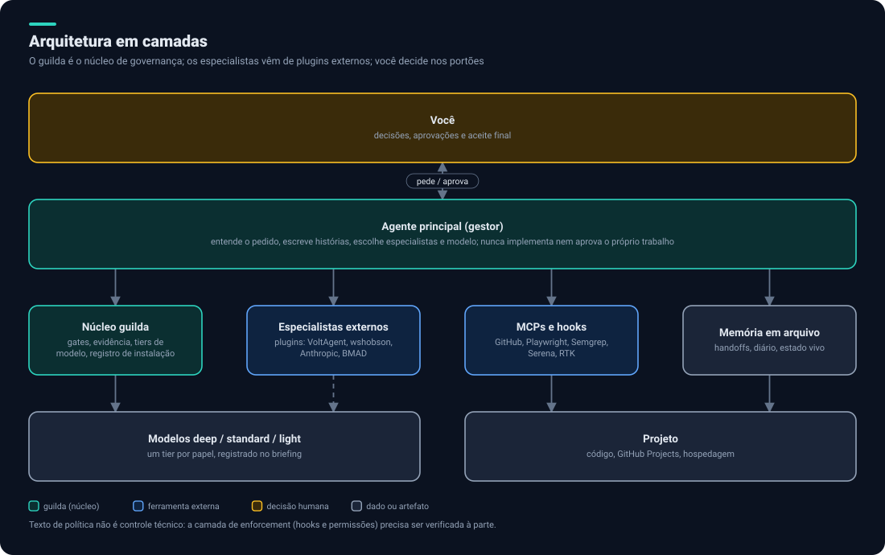

# Plataforma de agentes reutilizáveis: documentação do planejamento

Este repositório documenta o plano para ter **uma equipe de agentes de IA reaproveitável em todos os projetos**, do conceito ao deploy. A decisão central é usar o [`guilda`](https://github.com/allankltsn/guilda) (v2.0.0) como núcleo de governança e preencher os especialistas com ferramentas externas, deixando o `guilda` só onde nada externo cobre.



> **Estado atual: documentação e planejamento.** Nada foi instalado nem configurado nos projetos. Toda ferramenta citada precisa de proposta, revisão de segurança, sua aprovação e registro antes de entrar (veja [Segurança](docs/05-seguranca-e-privacidade.md)).

## Leia nesta ordem

| # | Documento | O que responde |
|---|---|---|
| 0 | [Visão geral](docs/00-visao-geral.md) | O que é, a decisão central, glossário |
| 1 | [Fluxo de trabalho](docs/01-fluxo-de-trabalho.md) | As 9 fases, o ciclo de uma história, orquestração e gates |
| 2 | [Agentes e fontes](docs/02-agentes-e-fontes.md) | Quem faz cada papel: externo, guilda ou lacuna |
| 3 | [Ferramentas](docs/03-ferramentas.md) | Um diagrama e um guia por ferramenta (19) |
| 4 | [Economia e modelos](docs/04-economia-e-modelos.md) | Tokens, tiers de modelo e gateways |
| 5 | [Segurança e privacidade](docs/05-seguranca-e-privacidade.md) | Os critérios, o que vaza e como impedir |
| 6 | [Stack e hospedagem](docs/06-stack-e-hospedagem.md) | Stack padrão, Hostinger, Cloudflare, Vercel, CI/CD |
| 7 | [GitHub Projects](docs/07-github-projects.md) | Estados, campos e boas práticas |
| 8 | [Guilda versus planejamento](docs/08-guilda-vs-planejamento.md) | Prós, contras e como agregar |
| 9 | [Lacunas e decisões](docs/09-lacunas-e-decisoes.md) | O que falta e o que só você decide |
| 10 | [Roteiro](docs/10-roteiro.md) | Marcos e critérios de pronto |

## Resumo em dez linhas

1. O `guilda` já existe (28 papéis, 11 ações, CLI, gates independentes, política de instalação). Reinventá-lo seria desperdício.
2. Regra de escolha: **ferramenta externa primeiro**; `guilda` só quando nada externo cobre; o que sobra vira decisão conjunta ([mapa](docs/02-agentes-e-fontes.md)).
3. Há **7 lacunas** sem cobertura em nenhum dos dois, como financeiro de produto, Cloudflare e teto de custo.
4. A governança (quem faz não aprova, evidência por snapshot, registro de instalação) vem do `guilda` e não é negociável.
5. Economia de tokens vem de camadas medidas uma a uma: RTK, Serena, handoffs em arquivo, tiers de modelo e, por último, Headroom.
6. Gateways de modelo de terceiros (como OmniRoute) ficam fora por ora: o código sairia da sua máquina.
7. Stack padrão: TypeScript, React, NestJS, Prisma, Postgres, pnpm, com divergências a alinhar entre os projetos.
8. Hospedagem: Cloudflare na borda, Vercel para o front, Hostinger (VPS) para back e dados.
9. O texto das regras não é controle técnico: falta escrever hooks e permissões de bloqueio.
10. Os projetos do produto estão em uma versão antiga do template e precisam ser atualizados para a 2.0.

## Como regenerar os diagramas

Os 37 diagramas em `docs/assets/` são SVG gerados por script, sem dependências:

```sh
python3 tools/diagramas/gerar.py
```

Para mudar um diagrama, edite `tools/diagramas/fluxos.py` ou `tools/diagramas/ferramentas.py` e gere de novo.

## Nota sobre este repositório ser público

Os projetos do produto são privados. Esta documentação cita só **tecnologias e padrões**, nunca domínios, endereços, nomes internos de repositórios, segredos ou trechos de código deles.

## Histórico

O primeiro rascunho, escrito antes de analisarmos o `guilda`, está em [`docs/historico/planejamento-v0.md`](docs/historico/planejamento-v0.md).
