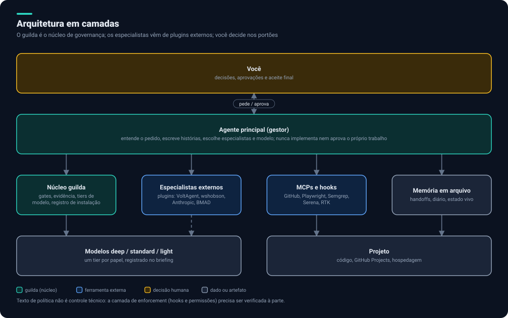

# 0. Visão geral

## O que queremos

Uma equipe de agentes de IA que **você reaproveita em todos os projetos**, cobrindo o ciclo inteiro de um produto: ideia, análise de requisitos, financeiro, marketing, protótipo, Scrum, design e UX, escrita de histórias e tarefas, backend, frontend, infraestrutura, segurança, revisão, QA, CI/CD, deploy e nuvem. Com agentes orquestrados, um fluxo de trabalho previsível, controle de custo em tokens e controle de vazamento de dados.

## A decisão central

Descobrimos que o [`guilda`](https://github.com/allankltsn/guilda) **já é esse produto**, na versão 2.0.0. Ele tem 28 papéis, 11 ações rápidas, 3 skills, uma CLI em Python (`guilda init`, `sync`, `upgrade`), 10 perfis, gates independentes, política de instalação com registro, camadas de modelo e contrato do GitHub Projects. O que falta nele é a parte de produto e negócio, os provedores Cloudflare e Vercel e o enforcement técnico das regras.

Por isso a decisão proposta é:

| Camada | Quem fornece |
|---|---|
| **Governança** (gates, evidência, tiers, registro de instalação, GitHub Projects, privacidade) | `guilda` |
| **Especialistas** (backend, frontend, segurança, QA, SRE, marketing, produto...) | Ferramentas externas, escolhidas primeiro |
| **Reserva** (papéis que nada externo cobre) | `guilda`, listados à parte |
| **Módulos novos** (fases 0 a 3, Cloudflare, Vercel, enforcement) | Roteiro da v3 do `guilda` |

A regra de escolha completa está em [Agentes e fontes](02-agentes-e-fontes.md).

## Premissas

- **Só Claude Code.** Você decidiu não suportar Codex nem outras ferramentas por enquanto.
- **Preferência por ferramentas externas** quando existem. O `guilda` é reserva.
- **Nada é instalado sem proposta e aprovação.** O `guilda` já exige isso e mantemos.
- **Documentação primeiro.** Este repositório só planeja; não altera os projetos.

## Glossário

| Termo | Significado |
|---|---|
| **Agente principal** | A sessão que gerencia: entende o pedido, escreve histórias, escolhe especialistas e modelo. Nunca implementa nem aprova o próprio trabalho |
| **Especialista** | Agente com função definida (backend, segurança, QA...), com ferramentas mínimas |
| **Gate** | Verificação independente obrigatória antes de concluir: revisão, segurança, privacidade, QA |
| **Snapshot** | Estado exato validado: SHA, base de comparação e arquivos não rastreados com hashes |
| **Handoff** | Resumo em arquivo (até 40 linhas) que o agente grava ao terminar; o principal lê só o caminho |
| **Tier** | Camada lógica de modelo: `deep`, `standard`, `light` |
| **Briefing** | Instrução de até 15 linhas apontando para arquivos, não colando contexto |
| **DoR / DoD** | Definition of Ready (pode começar) e Definition of Done (está pronto, com evidência) |
| **ADR** | Registro de decisão de arquitetura: contexto, opções, escolha, consequências |
| **Perfil** | Pacote opcional de regras ligado na instalação (por exemplo `github-projects`) |
| **MCP** | Servidor que dá ferramentas ao agente (GitHub, Playwright, Serena...) |
| **Hook** | Comando que o Claude Code executa em eventos, podendo bloquear ou reescrever ações |

## O que verificamos e o que não

Esta documentação separa três níveis de confiança, marcados no texto:

- **Verificado:** lido diretamente no repositório ou na documentação da fonte.
- **Alegado:** número ou promessa do próprio projeto, sem medição independente (por exemplo, percentuais de economia de tokens).
- **Inferido:** dedução nossa, a confirmar (por exemplo, o desenho da infraestrutura em VPS com Kubernetes).

## Limites desta análise

Os repositórios do produto foram lidos em clone raso: manifestos, workflows, READMEs e estrutura de pastas. **Não houve auditoria do código** à procura de vulnerabilidades. O catálogo do marketplace oficial foi lido só em parte. O README do BMAD não lista os papéis nem confirma suporte ao Claude Code.

Próximo: [Fluxo de trabalho](01-fluxo-de-trabalho.md).
