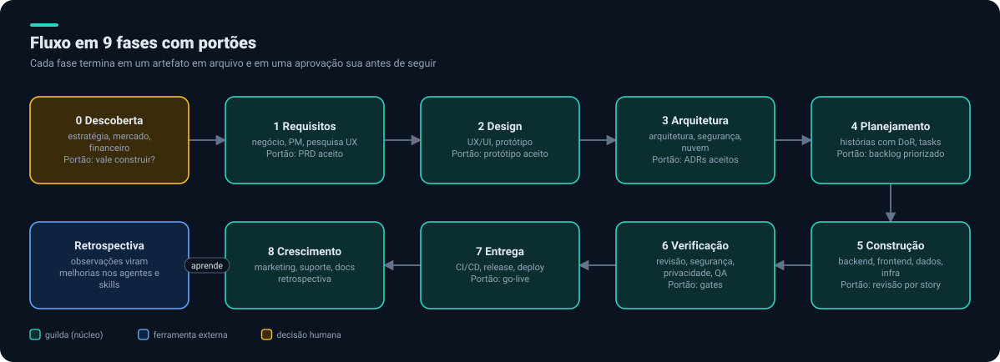
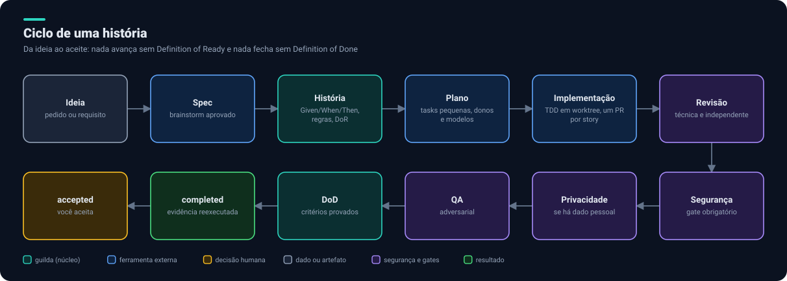
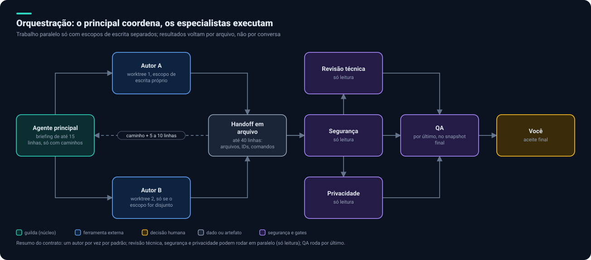
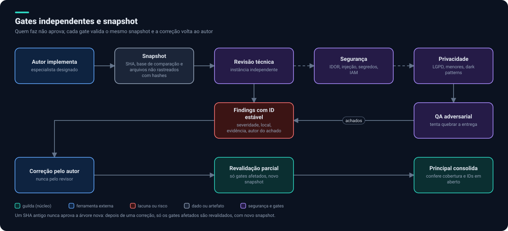

# 1. Fluxo de trabalho

## As 9 fases

Cada fase termina em um **artefato em arquivo** e em um **portão** (aprovação sua). Os agentes passam trabalho uns aos outros por arquivos, não por conversa: é mais barato, auditável e permite que um agente novo continue de onde o anterior parou.

| Fase | Agentes envolvidos | Artefato de saída | Portão |
|---|---|---|---|
| 0 Descoberta | estratégia de produto, mercado, financeiro, marketing | visão, mercado, modelo financeiro | Vale construir? |
| 1 Requisitos | análise de negócio, PM, pesquisa UX | PRD com requisitos funcionais e não funcionais, personas, métricas | PRD aceito |
| 2 Design | UX/UI, protótipo, design system | UX, protótipo navegável, tokens | Protótipo aceito |
| 3 Arquitetura | arquitetura, segurança, nuvem, dados | arquitetura, ADRs, modelo de ameaças | ADRs aceitos |
| 4 Planejamento | Scrum Master, Product Owner | épicos, histórias com DoR, tarefas e ordem | Backlog priorizado |
| 5 Construção | backend, frontend, dados, infra | código e testes, um PR por história | Revisão por história |
| 6 Verificação | revisão, segurança, privacidade, QA | relatórios, findings, PRs aprovados | Gates |
| 7 Entrega | CI/CD, release, deploy, SRE | pipeline, IaC, runbook, notas de release | Go-live |
| 8 Crescimento | marketing, suporte, documentação, retrospectiva | campanhas, docs, retro | |

As fases 0 a 3 são **novas** em relação ao `guilda` (que começa em histórias e execução). Quem as cobre está em [Agentes e fontes](02-agentes-e-fontes.md).

## O ciclo de uma história

Uma história só é despachada depois de **Definition of Ready**: narrativa, regras de negócio e critérios Given/When/Then. Só vira `completed` depois de **Definition of Done**, com evidência reexecutada pelo principal. O estado `accepted` é sempre seu. O quadro correspondente está em [GitHub Projects](07-github-projects.md).

## Orquestração

Regras que o principal segue:

1. **Um autor por vez** por padrão. Dois só em paralelo se os escopos de escrita forem disjuntos e cada contexto for pequeno.
2. **Briefing por referência:** até 15 linhas apontando para arquivos (especificação, plano, findings).
3. **Handoff em arquivo:** até 40 linhas; o agente devolve só o caminho e de 5 a 10 linhas.
4. **Não retomar agente pesado** (acima de cerca de 150 mil tokens): despachar um novo, com tarefa pequena, que leia o handoff.
5. **Revisão técnica, segurança e privacidade** rodam em paralelo (só leitura); **QA roda por último**, no snapshot final.
6. **Arquivos compartilhados** (lockfile, migrações, configuração raiz, contratos gerados) têm um dono por vez.
7. O Claude Code tem um modo experimental de equipes de agentes, desligado por padrão. Começamos com subagentes e reavaliamos.

## Gates independentes

- **Quem faz não aprova.** Autor, QA, revisão técnica, segurança e privacidade são instâncias distintas.
- **Independência é por instância, snapshot e função**, não só por tier. Em mudanças de alto risco, prefira validadores de outro tier ou provedor.
- Cada achado tem **ID estável**, severidade, local, evidência e autor. A correção volta ao autor original; quem achou confirma.
- Depois de uma correção, **só os gates afetados** são revalidados, com novo snapshot. Um SHA antigo nunca aprova a árvore nova.
- Silêncio, timeout ou orçamento esgotado **nunca** são aprovação.

## Níveis de autonomia

Configuráveis por projeto (proposta, ainda a implementar na v3):

| Nível | Comportamento |
|---|---|
| `manual` | Aprova cada passo |
| `portoes` (padrão) | Autonomia dentro de uma fase; para nos portões |
| `autonomo` | Só para em erro ou em evento de segurança |

Em qualquer nível, ações de produção (deploy, migração, IAM, destrutivas, rotação de segredo) exigem aprovação explícita. Veja [Segurança](05-seguranca-e-privacidade.md).

Próximo: [Agentes e fontes](02-agentes-e-fontes.md).
