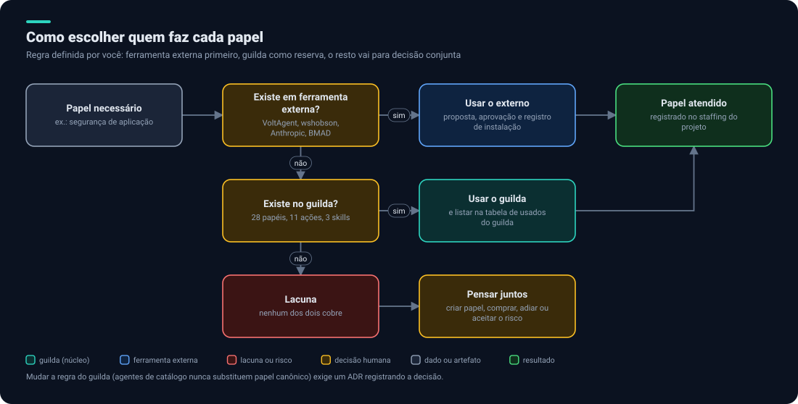
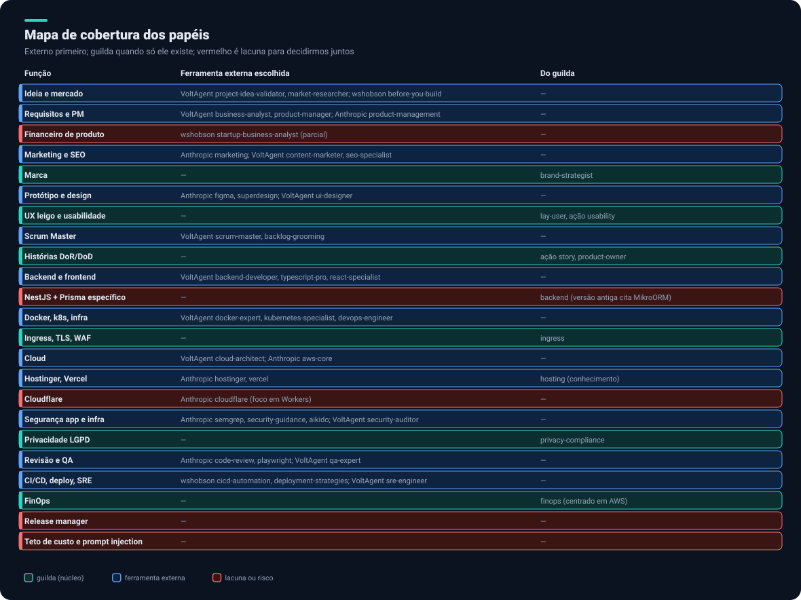

# 2. Agentes e fontes

## A regra de escolha

1. Existe em ferramenta **externa**? Usa-se o externo (com proposta, aprovação e registro).
2. Senão, existe no **`guilda`**? Usa-se o `guilda`, e o papel vai para a [lista dos usados do guilda](#b-usados-do-guilda).
3. Senão, é uma **lacuna**: vai para a [lista dos que não existem em lugar nenhum](#c-em-nenhum-dos-dois).

> **Atenção:** hoje o `guilda` diz que agentes de catálogo complementam e **nunca substituem** um papel canônico sem decisão registrada (`workflow/staffing.md`). Sua preferência por externos inverte essa regra, então precisa de um **ADR** registrando a decisão.

## Mapa de cobertura

## A. Resolvidos por ferramenta externa

| Função | Escolha externa | Fonte |
|---|---|---|
| Ideia e mercado | `project-idea-validator`, `market-researcher`, `competitive-analyst`; `before-you-build`, `startup-business-analyst` | VoltAgent, wshobson |
| Requisitos e PM | `business-analyst`, `product-manager`; plugin `product-management` | VoltAgent, Anthropic |
| Marketing e SEO | plugin `marketing`; `content-marketer`, `growth-loops`, `landing-page-copywriter`, `seo-specialist`; `seo-*` | Anthropic, VoltAgent, wshobson |
| Protótipo e design | `figma`, `superdesign`; `ui-designer`, `ux-researcher`, `ui-ux-tester`, `ux-microcopy-reviewer`; `accessibility-compliance` | Anthropic, VoltAgent, wshobson |
| Scrum Master | `scrum-master`, `backlog-grooming`, `project-manager` | VoltAgent |
| Backend | `backend-developer`, `node-specialist`, `typescript-pro`, `api-designer`, `auth-integration-engineer`, `webhook-engineer` | VoltAgent |
| Frontend | `frontend-developer`, `react-specialist`, `nextjs-developer` | VoltAgent |
| Banco de dados | `postgres-pro`, `database-administrator`; `database-migrations` | VoltAgent, wshobson |
| Docker, k8s, infra | `docker-expert`, `kubernetes-specialist`, `devops-engineer`, `platform-engineer`, `terraform-engineer`; `kubernetes-operations` | VoltAgent, wshobson |
| Cloud | `cloud-architect`; `cloud-infrastructure`; `aws-core`, `deploy-on-aws` | VoltAgent, wshobson, Anthropic |
| Segurança de aplicação | `security-guidance`, `semgrep`, `claude-security`, `sonarqube`; `security-auditor`, `penetration-tester` | Anthropic, VoltAgent |
| Segurança de infra | `aikido`; `security-engineer` | Anthropic, VoltAgent |
| Revisão | `code-review`, `pr-review-toolkit`, `code-simplifier`; `code-reviewer`, `architect-reviewer` | Anthropic, VoltAgent |
| QA | `playwright`; `qa-expert`, `test-automator`; `unit-testing`, `tdd-workflows` | Anthropic, VoltAgent, wshobson |
| CI/CD e deploy | `cicd-automation`, `deployment-strategies`, `deployment-validation`; `deployment-engineer` | wshobson, VoltAgent |
| SRE e incidentes | `sre-engineer`, `incident-responder`; `observability-monitoring`, `incident-response`; `sentry`, `datadog` | VoltAgent, wshobson, Anthropic |
| Hospedagem | plugins `hostinger`, `vercel`, `cloudflare` | Anthropic |
| Documentação | `technical-writer`, `documentation-engineer`; `c4-architecture` | VoltAgent, wshobson |
| Acesso ao GitHub | `github` (MCP) | Anthropic |
| Fases de desenvolvimento | `superpowers` | Anthropic |
| Pagamentos | `stripe`; `payment-integration` | Anthropic, VoltAgent |

Os nomes vêm das listas das próprias fontes. **Verificamos que existem; não avaliamos a qualidade de cada prompt.** Isso fica para a revisão de segurança da instalação ([como funciona](05-seguranca-e-privacidade.md#instalação-de-plugins)).

## B. Usados do guilda

Estes **não têm equivalente externo** encontrado e entram a partir do `guilda`. É a lista que você pediu.

| Do `guilda` | Por que entra |
|---|---|
| `privacy-compliance` e ação `privacy` | Cobre LGPD, menores, dados de saúde, dark patterns e a marcação `[LEGAL-REVIEW]`. Os externos são GDPR/CCPA e HIPAA. Pesa para um produto de saúde e treino |
| `brand-strategist` | O próprio `guilda` registra que o catálogo VoltAgent não tem agente de marca |
| `lay-user` e ação `usability` | Teste simulado com usuário leigo, sem equivalente |
| Ação `story` e `product-owner` | Histórias com DoR/DoD e Given/When/Then ligadas ao contrato do GitHub Projects. O BMAD pode cobrir parte, a verificar |
| `ingress` | VoltAgent só tem `network-engineer`, genérico. Cobre Traefik, TLS, WAF e rate limit |
| `finops` | Não há agente de FinOps externo. O do `guilda` é centrado em AWS e precisa de adaptação ao seu cenário |
| `scribe` e skills `readme-styling`, `dark-pipeline-svg`, `drawio-diagram` | Diagramas e README no estilo do projeto |
| `orchestration` (service mesh) | Pouco útil na stack atual (k3s e Traefik); baixa prioridade |
| **Governança:** `workflow/engineering`, `evidence`, `staffing`, `economy`, `polyrepo`, `session-continuity` | Não é agente: é o regulamento. Sem equivalente externo |
| **Camadas de modelo** `deep/standard/light` | Nenhum externo as tem; o `guilda` já gera o campo `model:` por papel |
| **Registro de instalação** e seus critérios | Controle de plugins, sem equivalente |

Observações:

- O papel `hosting` do `guilda` também fica, como **conhecimento complementar** ao plugin oficial `hostinger`: o plugin opera, o papel traz as convenções (SSL, DNS, PM2, rollback).
- Os agentes do `guilda` **instalados hoje nos projetos do produto** são de uma versão antiga: citam Python, AWS Lambda, MikroORM e Cognito, o que não bate com o código real (NestJS, Prisma, Kubernetes). A atualização para a 2.0 está no [roteiro](10-roteiro.md).

## C. Em nenhum dos dois

Detalhes e opções em [Lacunas e decisões](09-lacunas-e-decisoes.md).

| # | Lacuna | Situação |
|---|---|---|
| 1 | Analista financeiro de produto (preço, unit economics, runway, ponto de equilíbrio) | Cobertura parcial: `startup-business-analyst` e `business-analytics` (wshobson), só lidos por descrição. O `finance` da Anthropic é contabilidade; o `finops` do `guilda` é custo de nuvem |
| 2 | Especialista em Cloudflare (DNS, WAF, Turnstile, regras de cache, R2) | O plugin oficial é descrito com foco em Workers; o `ingress` do `guilda` é genérico |
| 3 | Backend específico da sua stack (NestJS, Prisma, Zod, `jose`) | Os externos são genéricos; o `backend` do `guilda` instalado cita MikroORM |
| 4 | Teto de custo com corte automático e detecção de loop | Só existe relatório (`session-report`) |
| 5 | Defesa contra prompt injection | Nenhum dos dois |
| 6 | Release manager (notas de versão, changelog, coordenação) | Só Changesets em um dos pacotes |
| 7 | Enforcement técnico das regras (hooks e permissões) | O `guilda` é só texto. `block-no-verify` (wshobson) e `hookify` (Anthropic) ajudam, mas as regras de bloqueio ainda precisam ser escritas |

## O que ainda precisa ser verificado

- **BMAD:** o README consultado não lista os papéis (analista, PM, arquiteto, Scrum Master...) nem confirma suporte ao Claude Code.
- **Marketplace oficial:** lido em parte. `frontend-design` e `claude-mem` não foram confirmados no trecho lido.
- **Prompts dos agentes:** não revisamos o conteúdo de nenhum.
- **`marketingskills`:** conhecido só por resultados de busca.

Próximo: [Ferramentas](03-ferramentas.md).
