# 3. Ferramentas

Um guia por ferramenta, cada um com um diagrama do **fluxo real de dados**. Os comandos de instalação vêm da documentação de cada fonte em novembro de 2026: **confira antes de executar**. Nada é instalado sem passar pelo [processo de aprovação](05-seguranca-e-privacidade.md#instalação-de-plugins).

## Visão rápida e decisão proposta

| # | Ferramenta | Função | Decisão proposta |
|---|---|---|---|
| 1 | [Superpowers](#superpowers) | Motor de fases de desenvolvimento | **Adotar** |
| 2 | [BMAD-METHOD](#bmad-method) | Fases de produto e histórias | **Avaliar** (verificar suporte) |
| 3 | [VoltAgent](#voltagent) | Catálogo de subagentes | **Adotar** por categoria |
| 4 | [wshobson/agents](#wshobsonagents) | Plugins de engenharia | **Adotar** poucos |
| 5 | [Marketplace oficial](#marketplace-oficial-da-anthropic) | Plugins curados | **Adotar** |
| 6 | [RTK](#rtk) | Comprime saída de shell | **Adotar** |
| 7 | [Serena](#serena) | Leitura de código por símbolo | **Adotar** |
| 8 | [Headroom](#headroom) | Comprime contexto | **Avaliar**, por último |
| 9 | [claude-mem](#claude-mem) | Memória entre sessões | **Avaliar** com revisão de privacidade |
| 10 | [Context7](#context7) | Documentação atual de bibliotecas | **Adotar** |
| 11 | [Semgrep](#semgrep) | Varredura a cada edição | **Adotar** com ressalva de privacidade |
| 12 | [Playwright MCP](#playwright-mcp) | QA em navegador real | **Adotar** |
| 13 | [GitHub e Projects](#github-e-projects) | Quadro e issues | **Adotar** |
| 14 | [Hostinger](#hostinger) | Operar a hospedagem | **Adotar** |
| 15 | [Cloudflare](#cloudflare) | Borda, WAF, edge | **Adotar** + papel novo |
| 16 | [Vercel](#vercel) | Previews e produção do front | **Adotar** |
| 17 | [Protótipo](#protótipo) | Figma e geradores de UI | **Adotar** parcial |
| 18 | [Task Observer](#task-observer) | Retrospectiva das skills | **Avaliar** |
| 19 | [Gateway de modelos](#gateway-de-modelos) | Roteamento e fallback | **Evitar agora** |

### Ordem de adoção sugerida

1. **Base:** Superpowers, marketplace oficial, GitHub, Playwright.
2. **Qualidade e segurança:** Semgrep, `security-guidance`, `code-review`.
3. **Economia:** medir linha de base, depois RTK, depois Serena.
4. **Especialistas:** VoltAgent e wshobson, por perfil.
5. **Hospedagem:** Hostinger, Vercel, Cloudflare.
6. **Avaliar depois:** Headroom, claude-mem, Task Observer, BMAD.

---

## Fases e orquestração

### Superpowers

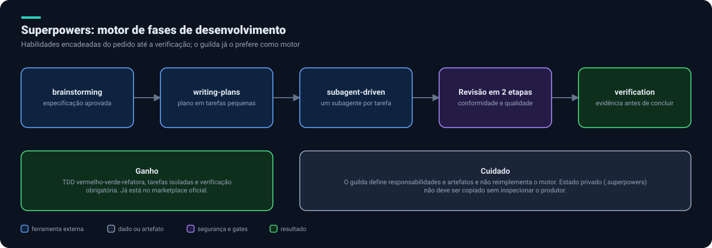

- **O que é:** conjunto de habilidades que encadeia o pedido até a verificação: brainstorming, plano, subagente por tarefa, revisão em duas etapas e verificação antes de concluir. Impõe TDD.
- **Onde entra:** fases 4 a 6 (planejar, construir, verificar). O `guilda` já o declara como o motor de fases preferido; ele define responsabilidades e artefatos, não reimplementa o motor.
- **Instalação (fonte):** `/plugin install superpowers@claude-plugins-official`.
- **Cuidado:** não copiar o estado privado `.superpowers` sem entender quem o produz.

### BMAD-METHOD

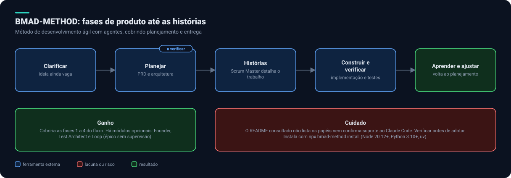

- **O que é:** método de desenvolvimento ágil com agentes. A versão estável é a 6.12; há módulos opcionais (Founder, Test Architect, Loop para executar um épico sem supervisão).
- **Onde entra:** fases 1 a 4, em especial PRD, arquitetura e histórias.
- **Instalação (fonte):** `npx bmad-method install` (Node 20.12+, Python 3.10+, `uv`).
- **A verificar:** o README **não lista os papéis nem confirma suporte ao Claude Code**. Antes de adotar, abrir a documentação do método e testar em um projeto descartável.

---

## Catálogos de especialistas

### VoltAgent

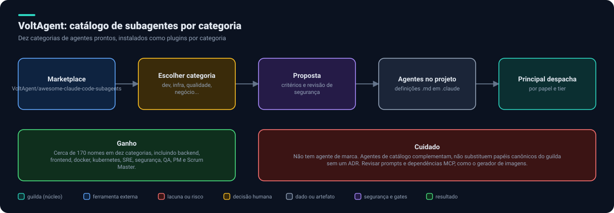

- **O que é:** catálogo com cerca de 170 subagentes em dez categorias (desenvolvimento, linguagens, infraestrutura, qualidade e segurança, dados e IA, experiência de desenvolvedor, domínios especializados, negócio e produto, meta e orquestração, pesquisa).
- **Onde entra:** quase todos os papéis de especialista das fases 0 a 7.
- **Instalação (fonte):** `claude plugin marketplace add VoltAgent/awesome-claude-code-subagents`; depois plugins por categoria, como `voltagent-core-dev`, `voltagent-lang`, `voltagent-biz`, `voltagent-qa-sec`.
- **Cuidado:** não tem agente de marca. Revisar prompts e dependências, como o gerador de imagens que depende de um MCP de terceiros.

### wshobson/agents

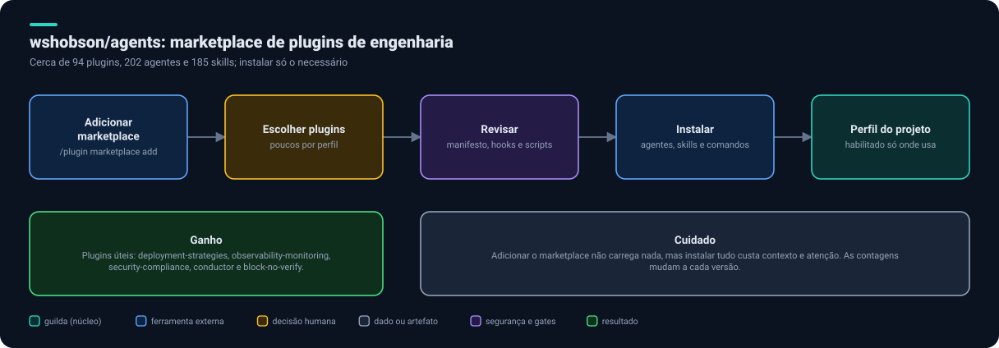

- **O que é:** marketplace com cerca de 94 plugins, 202 agentes e 185 skills (as contagens variam por versão).
- **Onde entra:** estratégias de deploy, observabilidade, conformidade, arquitetura C4 e o fluxo `conductor`. Úteis: `deployment-strategies`, `observability-monitoring`, `security-compliance`, `database-migrations`, `block-no-verify`.
- **Instalação (fonte):** `/plugin marketplace add wshobson/agents`, depois instalar plugins individuais.
- **Cuidado:** adicionar o marketplace não carrega nada, mas instalar muito custa contexto. Escolher poucos por perfil.

### Marketplace oficial da Anthropic

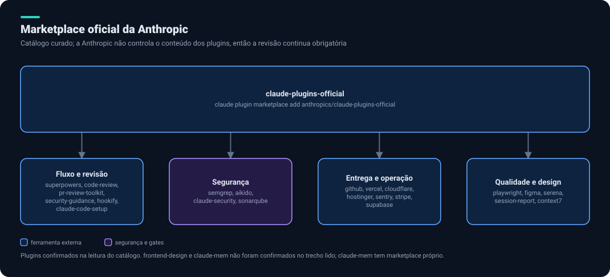

- **O que é:** catálogo curado, adicionado automaticamente na primeira sessão interativa. A Anthropic avisa que **não controla** o conteúdo dos plugins.
- **Confirmados na leitura:** `superpowers`, `code-review`, `pr-review-toolkit`, `code-simplifier`, `hookify`, `claude-code-setup`, `security-guidance`, `semgrep`, `aikido`, `claude-security`, `sonarqube`, `playwright`, `github`, `vercel`, `cloudflare`, `hostinger`, `sentry`, `stripe`, `supabase`, `figma`, `serena`, `context7`, `session-report`.
- **Instalação:** `/plugin marketplace add anthropics/claude-plugins-official` e `/plugin install <nome>@claude-plugins-official`.
- **Não confirmados:** `frontend-design` e `claude-mem` (este tem marketplace próprio).

---

## Economia de tokens

### RTK

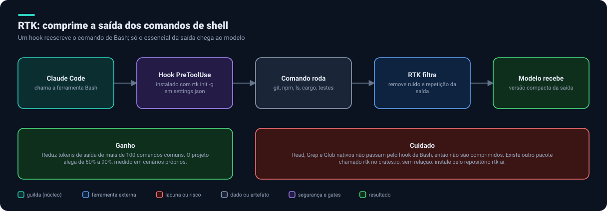

- **O que é:** proxy de linha de comando que comprime a saída de mais de 100 comandos de desenvolvimento antes de chegar ao modelo.
- **Onde entra:** durante a construção e a verificação, em todo comando de shell.
- **Instalação (fonte):** `rtk init -g` (configura um hook `PreToolUse` em `~/.claude/settings.json`); conferir com `rtk --version` e `rtk gain`.
- **Alegado:** 60% a 90% de redução, em cenários do próprio projeto.
- **Cuidados:** não cobre Read, Grep e Glob nativos. Existe outro pacote `rtk` no crates.io sem relação; instalar pelo repositório `rtk-ai`. O `guilda` já tem instruções em `integrations/rtk`.

### Serena

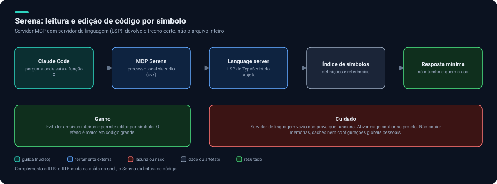

- **O que é:** servidor MCP que usa servidores de linguagem (LSP) para buscar e editar código por símbolo, sem ler arquivos inteiros.
- **Onde entra:** leitura e edição de código na construção e na revisão. Complementa o RTK.
- **Instalação (fonte):** plugin `serena` no marketplace oficial, ou o servidor via `uvx` conforme o README do projeto.
- **Cuidados:** servidor de linguagem vazio não prova que funciona; ativar exige confiar no projeto; não copiar memórias, caches nem configurações pessoais.

### Headroom

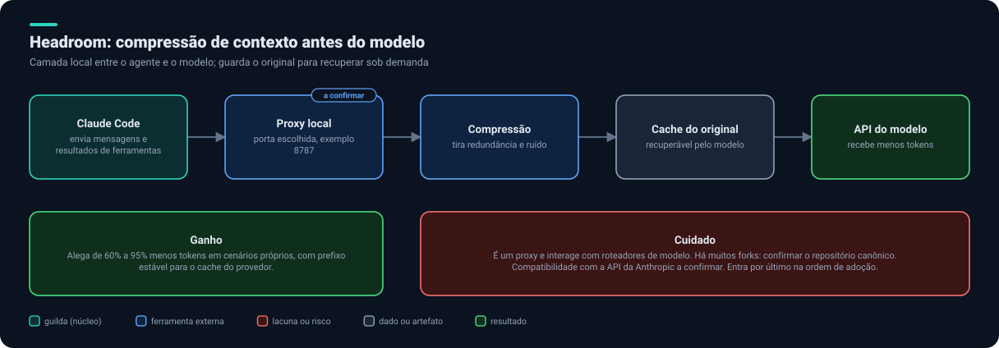

- **O que é:** camada local entre o agente e o modelo que comprime o contexto e guarda o original para recuperação. Funciona como biblioteca, proxy (`headroom proxy --port 8787`) ou MCP.
- **Alegado:** 60% a 95% de redução.
- **Decisão:** avaliar por último, porque é um proxy e interage com roteadores. Confirmar o repositório canônico (há muitos forks) e a compatibilidade com a API da Anthropic.

### claude-mem

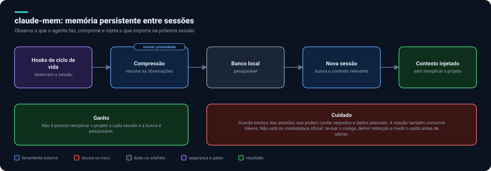

- **O que é:** plugin de memória persistente: observa a sessão por hooks, comprime, guarda em banco local e injeta contexto relevante em sessões futuras.
- **Instalação (fonte):** adicionar o marketplace `thedotmack/claude-mem` e instalar `claude-mem` (Node 18+).
- **Cuidado principal:** guarda trechos das sessões, que podem incluir segredos e dados pessoais; a injeção também gasta tokens. **Revisar o código, definir retenção e medir o saldo** antes de adotar. O `guilda` já oferece continuidade por arquivos (handoffs, diário, estado vivo) como alternativa auditável.

### Context7

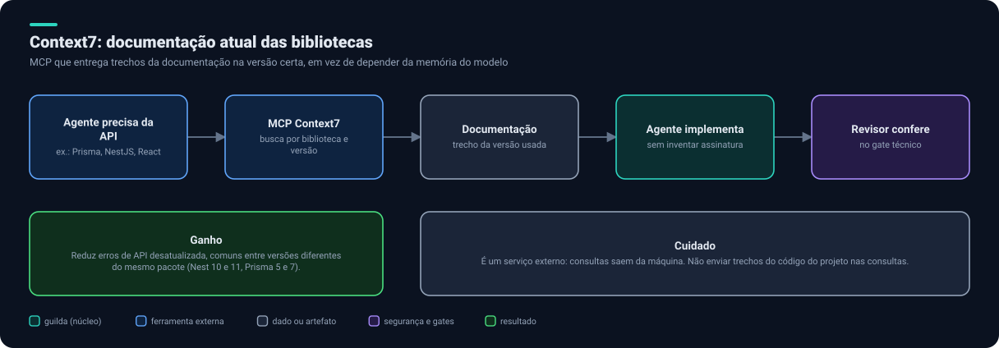

- **O que é:** MCP que entrega documentação de bibliotecas na versão certa.
- **Onde entra:** implementação, sobretudo com versões diferentes do mesmo pacote entre projetos (NestJS 10 e 11, Prisma 5 e 7).
- **Instalação:** plugin `context7` do marketplace oficial.
- **Cuidado:** serviço externo. Não enviar trechos do seu código nas consultas.

---

## Segurança e qualidade

### Semgrep

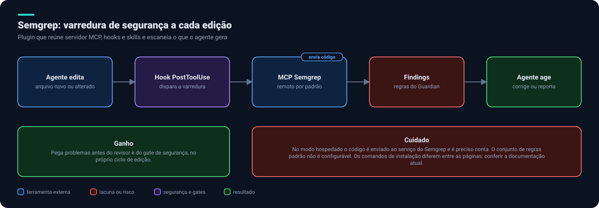

- **O que é:** plugin que reúne MCP, hooks e skills e escaneia os arquivos gerados pelo agente a cada edição.
- **Instalação (fonte):** o plugin oferece a skill `/semgrep-plugin:setup_semgrep_plugin`. A documentação beta mostra também `claude mcp add --scope user semgrep semgrep mcp`. **Os caminhos diferem entre páginas: confirmar na documentação atual.**
- **Cuidados:** o modo hospedado **envia código ao serviço** e exige conta; as regras padrão não são configuráveis.

### Playwright MCP

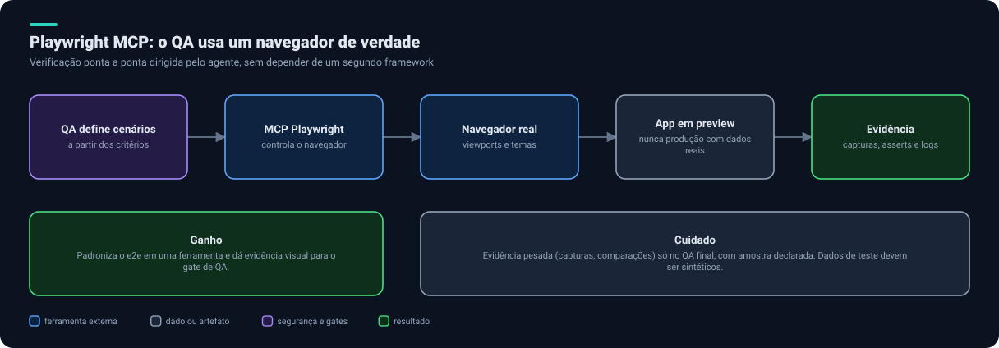

- **O que é:** MCP da Microsoft que dá ao agente um navegador real.
- **Onde entra:** gate de QA e verificação de front em vários tamanhos e temas. Proposta: padronizar o e2e em Playwright.
- **Instalação:** plugin `playwright` do marketplace oficial.
- **Cuidados:** rodar contra preview, nunca produção com dados reais; evidência pesada só no QA final.

---

## Projeto e entrega

### GitHub e Projects

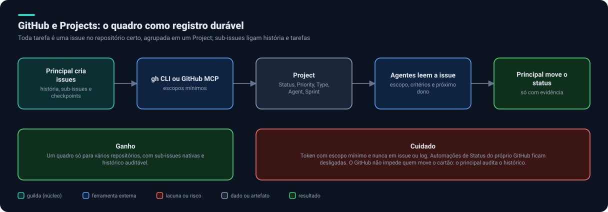

- **O que é:** o quadro como registro durável. Detalhes em [GitHub Projects](07-github-projects.md).
- **Instalação:** plugin `github` do marketplace oficial ou a CLI `gh`, com escopos mínimos (`repo` e `project`).
- **Cuidado:** nunca guardar token em issue, arquivo ou log.

### Hostinger

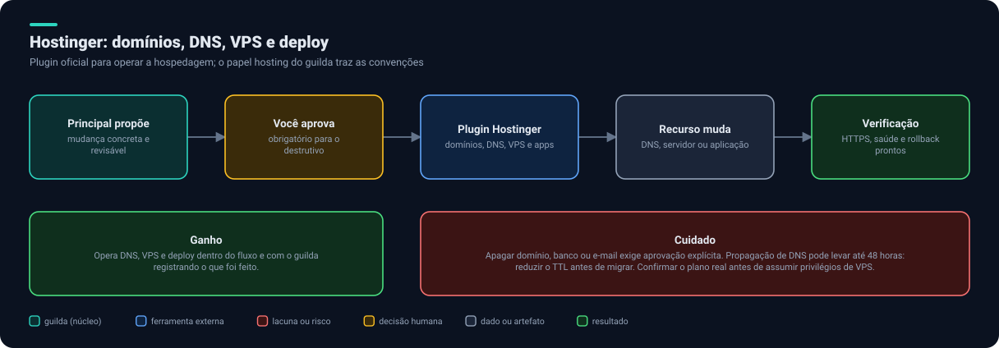

- **O que é:** plugin oficial que implanta sites e apps e gerencia domínios, DNS e VPS.
- **Complemento:** o papel `hosting` do `guilda` traz as convenções (HTTPS, DNS e TTL, PM2, rollback).
- **Cuidados:** apagar domínio, banco ou e-mail exige aprovação explícita; a propagação de DNS pode levar até 48 horas.

### Cloudflare

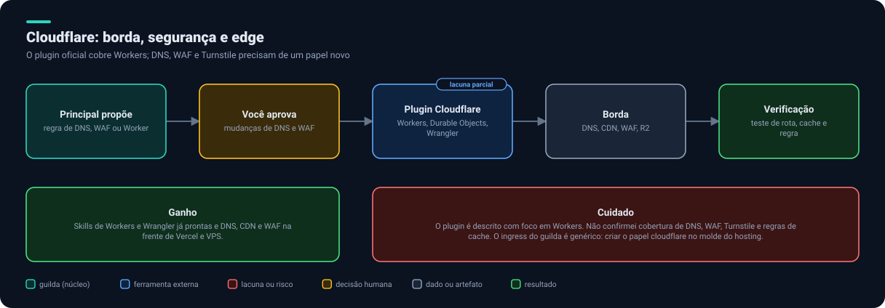

- **O que é:** plugin oficial com skills de Workers, Durable Objects, Agents SDK e Wrangler.
- **Lacuna:** não confirmamos cobertura de **DNS, WAF, Turnstile e regras de cache**. Criar um papel `cloudflare` no molde do `hosting` ([lacuna 2](09-lacunas-e-decisoes.md)).

### Vercel

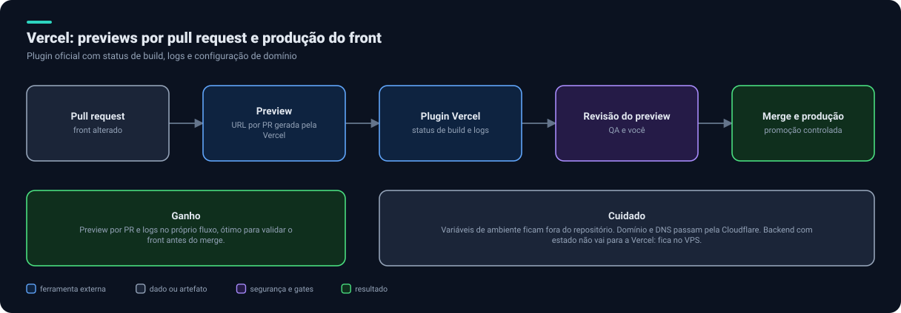

- **O que é:** plugin oficial com deploys, status de build, logs e domínios.
- **Onde entra:** previews por pull request do front.
- **Cuidados:** variáveis de ambiente fora do repositório; backend com estado não vai para a Vercel.

### Protótipo

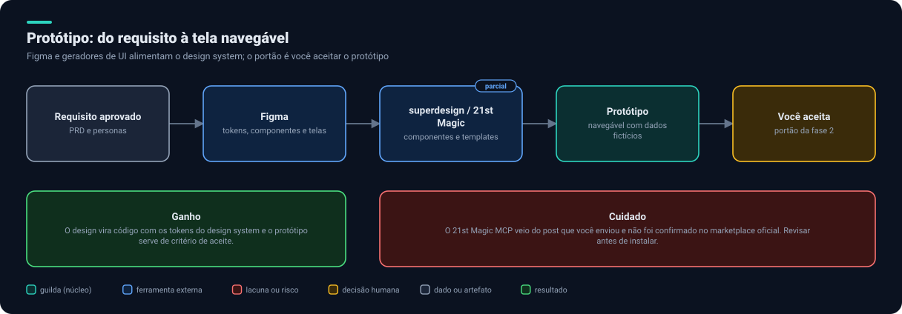

- **O que é:** cadeia da fase 2: `figma` lê tokens e componentes; `superdesign` cria interface em canvas; o 21st Magic MCP (do post que você enviou) oferece componentes e templates.
- **A verificar:** o 21st Magic **não foi confirmado** no marketplace oficial; revisar antes de instalar.

---

## Aprendizado e modelos

### Task Observer

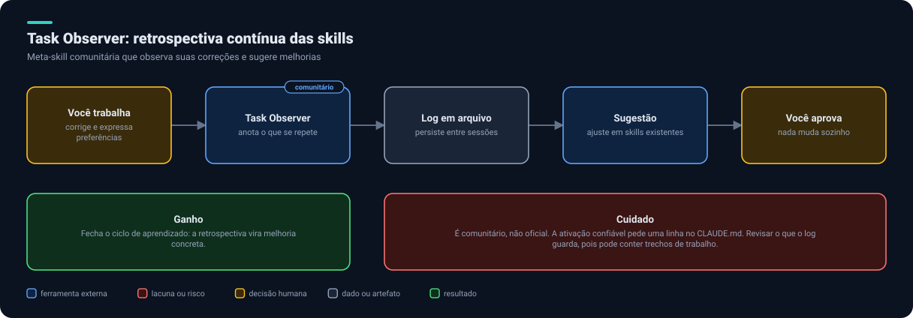

- **O que é:** meta-skill comunitária que observa suas correções e sugere melhorias nas suas outras skills. Você aprova cada mudança.
- **Instalação (fonte):** em `.claude/skills/task-observer/` e uma linha no `CLAUDE.md` para ativação confiável.
- **Cuidado:** não é oficial; revisar o que o log guarda.

### Gateway de modelos

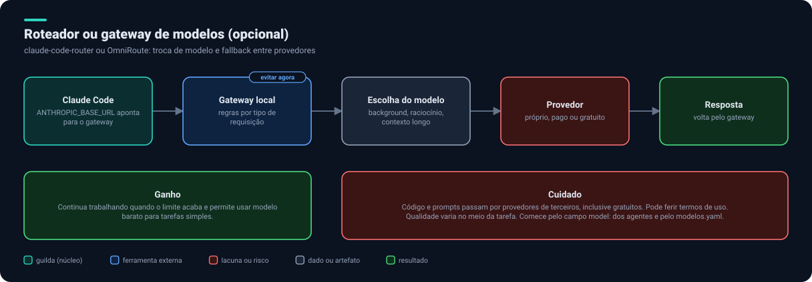

- **O que é:** `claude-code-router` ou OmniRoute: um proxy local que troca de modelo por tipo de requisição e faz fallback entre provedores.
- **Decisão: evitar agora.** Código e prompts passariam por provedores de terceiros, inclusive gratuitos. Pode ferir termos de uso e a qualidade varia no meio da tarefa. As camadas 1 e 2 de [Economia e modelos](04-economia-e-modelos.md#gerenciador-de-modelos) resolvem a maior parte.

Próximo: [Economia e modelos](04-economia-e-modelos.md).
