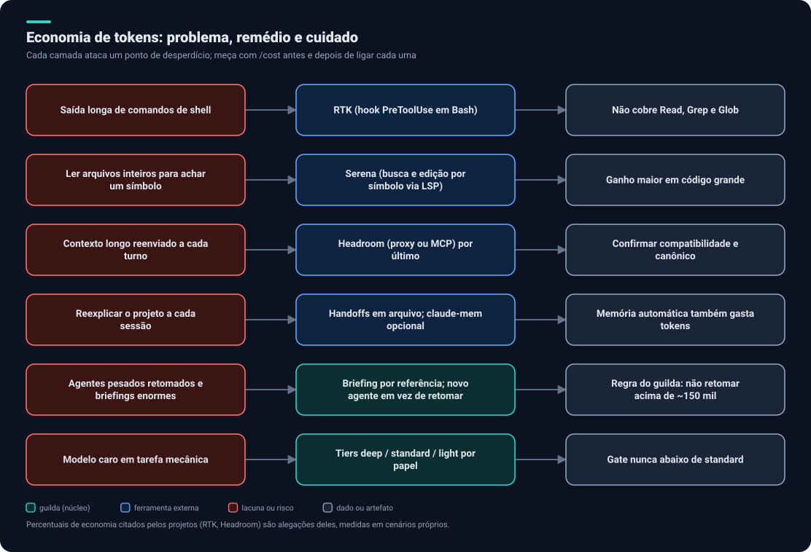
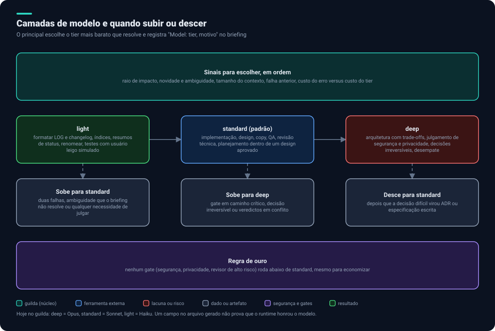

# 4. Economia e modelos

## O princípio

**A economia muda como se executa, nunca se verifica.** Nenhum gate é removido, mesclado ou rebaixado para economizar tokens. Se uma regra de economia conflita com um gate, o gate vence e o custo é aceito. Essa é a regra do `guilda` e a mantemos.

## Onde os tokens vão e o que ataca cada ponto

| Desperdício | Remédio | Ferramenta ou regra |
|---|---|---|
| Saída longa de comandos | Comprimir antes de chegar ao modelo | [RTK](03-ferramentas.md#rtk) |
| Ler arquivos inteiros para achar um símbolo | Busca por símbolo | [Serena](03-ferramentas.md#serena) |
| Contexto longo reenviado a cada turno | Compressão de contexto | [Headroom](03-ferramentas.md#headroom), por último |
| Reexplicar o projeto a cada sessão | Handoffs em arquivo; memória opcional | Regra do `guilda`; [claude-mem](03-ferramentas.md#claude-mem) |
| Agentes pesados retomados, briefings enormes | Briefing por referência; novo agente em vez de retomar | Regra do `guilda` |
| Modelo caro em tarefa mecânica | Tier certo por papel | Tiers do `guilda` |

> Os percentuais de redução citados por RTK (60% a 90%) e Headroom (60% a 95%) são **alegações dos próprios projetos**, medidas em cenários deles. O resultado no seu código só se conhece medindo.

## Regras de economia do guilda (mantidas)

1. **Um autor por vez;** paralelo só com escopos de escrita disjuntos e contextos pequenos.
2. **Briefing por referência:** até 15 linhas apontando para arquivos.
3. **Handoff em arquivo:** até 40 linhas; devolver só o caminho e de 5 a 10 linhas.
4. **Não retomar agente pesado** (cerca de 150 mil tokens): despachar novo, com tarefa pequena.
5. **Escopo antes da suíte:** só os testes do escopo tocado e as checagens estáticas durante a escrita; suíte completa e e2e uma vez, no fim.
6. **Evidência pesada só no fim:** capturas de tela e comparações visuais no QA final, com amostra declarada.
7. **Gates uma vez por snapshot:** depois de uma correção, revalidar só o que o delta afeta.
8. **Relatórios enxutos:** veredito, IDs e caminhos; detalhes em arquivo.
9. **Orçamento por onda:** registrar tokens por agente; se um passar de cerca de 250 mil, dividir a tarefa.
10. **Bookkeeping barato:** registros de uma linha são anexados direto pelo principal, sem despachar agente.

## Camadas de modelo

| Tier | Hoje | Para que serve | Não usar para |
|---|---|---|---|
| `deep` | Opus | Arquitetura com trade-offs, julgamento de segurança e privacidade, decisões irreversíveis, desempate | Formatação, implementação rotineira |
| `standard` (padrão) | Sonnet | Implementação, design, copy, QA, revisão técnica, planejamento | Mecânica trivial; decisões que vão para `deep` |
| `light` | Haiku | Formatar logs e changelog, índices, resumos, renomear, usuário leigo simulado | Qualquer coisa que aprove, bloqueie, desenhe ou proteja |

O principal registra no briefing `Model: <tier> - <motivo>`. Se existir um modelo acima de `deep` no ambiente, só com aprovação sua e motivo crítico declarado. **Gates nunca rodam abaixo de `standard`.** Um campo `model:` em arquivo gerado não prova que o ambiente o honrou.

## Gerenciador de modelos

Três camadas, da mais simples para a mais complexa:

1. **Nativo (usar já):** campo `model:` no arquivo de cada agente, mais as variáveis `ANTHROPIC_DEFAULT_*_MODEL` e `CLAUDE_CODE_SUBAGENT_MODEL`.
2. **Tiers do guilda:** o `template.json` mapeia tier para modelo e esforço; a CLI gera o campo `model:` de cada papel. Mudar um tier no projeto: `--tier papel=tier` em `init` ou `sync`. **Isto já é o gerenciador de modelos**; não precisamos construir outro.
3. **Gateway (opcional):** só se surgir um problema concreto de custo ou limite. Ver [gateway](03-ferramentas.md#gateway-de-modelos) e a análise de riscos abaixo.

### Sobre o OmniRoute e gateways gratuitos

O post que você enviou promete "uso quase ilimitado" ligando o Claude Code a mais de 200 provedores gratuitos. Pontos a considerar:

- **Seu código e seus prompts passam a trafegar por provedores de terceiros**, incluindo gratuitos. Para código de cliente, segredos ou dados pessoais, é um risco real ([fronteiras de dados](05-seguranca-e-privacidade.md#para-onde-o-dado-pode-ir)).
- "Gratuito" tem limites de taxa e qualidade variável; a sessão "nunca para" à custa de trocar de modelo no meio da tarefa.
- Rotear uma assinatura por um proxy pode ferir os termos do provedor. Conferir.
- Os números variam entre fontes (de 231 a 352 provedores) e o projeto depende de Redis para recursos completos. Há muitos forks.
- O post é de divulgação ("comente CLAUDE"): tratar as promessas como ponto de partida.

## Ordem de adoção e medição

1. **Linha de base:** em um projeto piloto, registrar o custo de uma tarefa típica com `/cost` e o plugin `session-report`.
2. **RTK:** ligar e comparar.
3. **Serena:** ligar e comparar.
4. **claude-mem:** só depois da revisão de privacidade; medir o saldo (ele injeta contexto também).
5. **Headroom:** por último, porque é proxy.

**Ligar uma de cada vez**, sempre comparando com a linha de base. Métricas: tokens e custo por fase, taxa de aprovação nos gates, retrabalho por história.

Próximo: [Segurança e privacidade](05-seguranca-e-privacidade.md).
