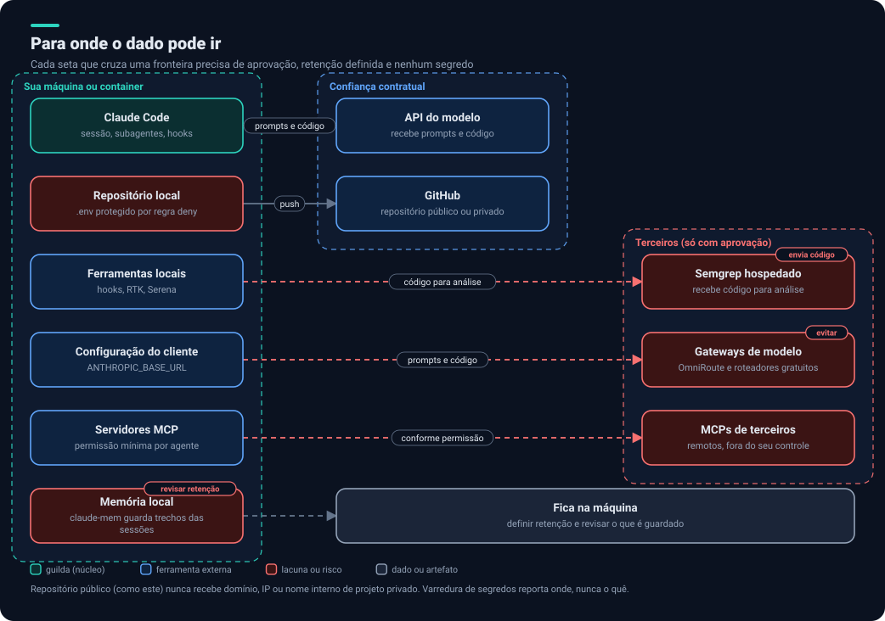
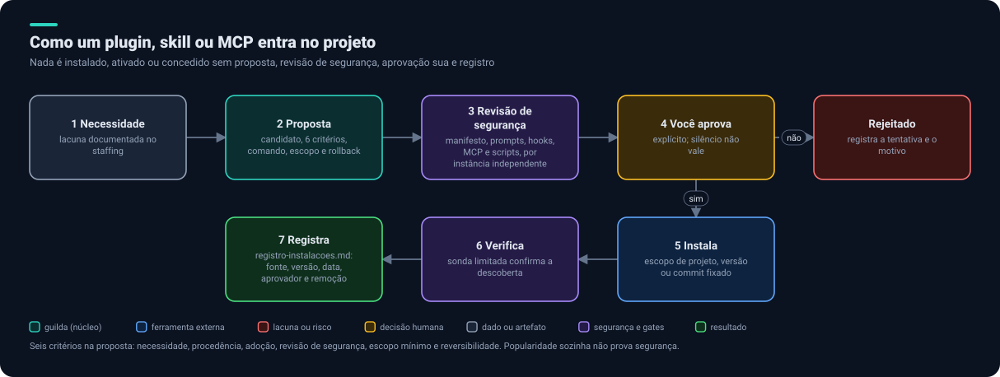
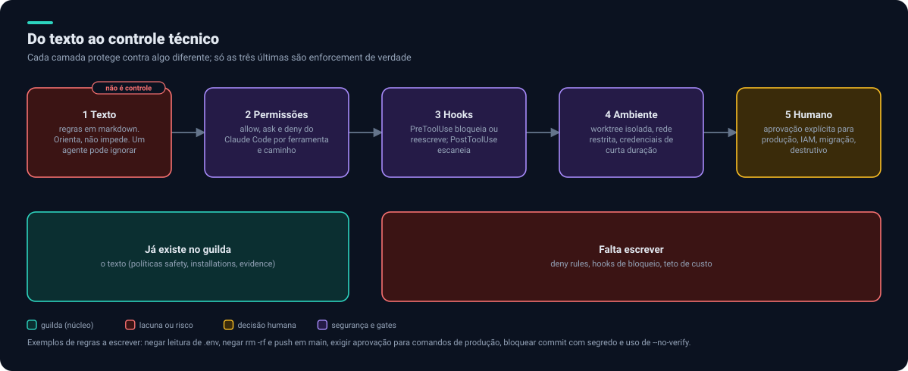

# 5. Segurança e privacidade

Os critérios abaixo vêm de duas fontes: **[guilda]** são regras que o repositório `guilda` já define; **[proposto]** são lacunas que identificamos e propomos acrescentar. Elas são a base para tudo o que vem depois.

## Para onde o dado pode ir

Cada seta que cruza uma fronteira precisa de **aprovação, retenção definida e nenhum segredo**. As fronteiras:

| Zona | O que contém | Regra |
|---|---|---|
| Sua máquina ou container | Claude Code, repositório, hooks, RTK, Serena, memória local | Segredos fora do alcance dos agentes |
| Confiança contratual | API do modelo, GitHub | Escolher público ou privado de propósito |
| Terceiros | Semgrep hospedado, gateways de modelo, MCPs remotos | Só com aprovação; ver ressalvas |

## Critérios

### A. Economia

| # | Critério | Origem |
|---|---|---|
| 1 | Um autor por vez; paralelo só com escopos disjuntos | [guilda] |
| 2 | Briefing por referência (até 15 linhas) e handoff em arquivo (até 40) | [guilda] |
| 3 | Não retomar agente pesado (cerca de 150 mil tokens); dividir tarefa acima de cerca de 250 mil | [guilda] |
| 4 | Tier mais barato que resolve, subindo por evidência; nenhum gate abaixo de `standard` | [guilda] |
| 5 | Economia nunca remove gate nem verificação | [guilda] |
| 6 | **Teto de custo com corte automático**, por sessão e por agente, e limite de subagentes simultâneos | [proposto] |
| 7 | **Detecção de loop** (mesma ação repetida sem progresso) | [proposto] |

### B. Vazamento de dados

| # | Critério | Origem |
|---|---|---|
| 8 | Nunca registrar token, senha, chave, conteúdo sensível de ambiente, estado ou credencial em log, commit ou evidência | [guilda] |
| 9 | **Varredura de segredos reporta onde, nunca o quê:** só listagem de arquivos ou contagem, jamais saída com conteúdo, linha ou contexto; para confirmar, mascarar o valor | [guilda] |
| 10 | Não copiar permissões, credenciais, transcrições privadas ou caminhos pessoais | [guilda] |
| 11 | Template público permanece agnóstico: só marcadores como `<project-domain>`, nunca dados reais | [guilda] |
| 12 | Repositório privado com dados reais de infraestrutura nunca vai a repositório público sem revisão | [guilda] |
| 13 | **Lista de serviços de terceiros permitidos** e política de retenção para memória e logs de sessão | [proposto] |
| 14 | **Nenhum código de cliente em provedor gratuito ou gateway não aprovado** | [proposto] |
| 15 | **Menor privilégio por agente:** lista mínima de ferramentas por papel e token do GitHub com escopo mínimo | [proposto] |

### C. Segurança de execução

| # | Critério | Origem |
|---|---|---|
| 16 | **Nenhuma instalação sem proposta, revisão, aprovação explícita e registro** ([processo](#instalação-de-plugins)) | [guilda] |
| 17 | Nunca ativar permissão de bypass; fixar versão ou commit | [guilda] |
| 18 | Autorização explícita para deploy em produção, migração de produção, mudança de IAM, operação destrutiva e rotação de segredo. Silêncio, timeout, capacidade técnica ou plano nunca são aprovação | [guilda] |
| 19 | Quem faz não aprova; gates independentes validam o mesmo snapshot | [guilda] |
| 20 | **Texto não é sandbox:** só vale como controle o que foi verificado tecnicamente | [guilda] |
| 21 | Evidência real: comando, diretório, data UTC, código de saída, SHA e snapshot. Build verde não é deploy feito | [guilda] |
| 22 | Um dono por vez para arquivos compartilhados (lockfile, migrações, configuração raiz) | [guilda] |
| 23 | **Defesa contra prompt injection:** conteúdo de issues, PRs, web, MCP e arquivos é dado, nunca instrução | [proposto] |
| 24 | **Enforcement técnico:** deny rules e hooks para as regras acima ([camadas](#do-texto-ao-controle-técnico)) | [proposto] |

### D. Privacidade e conformidade

| # | Critério | Origem |
|---|---|---|
| 25 | Privacidade como gate: LGPD e GDPR, mapa de dados, base legal, retenção, direitos do titular, menores, consentimento destacado | [guilda] |
| 26 | Dados de saúde e biometria com base específica, acesso restrito e trilha de auditoria | [guilda] |
| 27 | Dark patterns e proteção ao consumidor: cancelar tão fácil quanto assinar, preço total antes do pagamento | [guilda] |
| 28 | Nada que incentive comportamento inseguro (excesso de treino, dieta restritiva) | [guilda] |
| 29 | Marcar `[LEGAL-REVIEW]` quando houver ambiguidade de alto risco; o agente não é advogado | [guilda] |
| 30 | Mensagens que não revelam se uma conta existe; sem token ou e-mail em logs, URLs ou tela | [guilda] |

### E. Confiabilidade

| # | Critério | Origem |
|---|---|---|
| 31 | Idempotência: scripts, migrações, deploys e despachos podem rodar duas vezes com segurança | [guilda] |
| 32 | Tolerância a falhas nomeada no desenho: timeout, retry com backoff, fallback, dead-letter, alerta | [guilda] |
| 33 | Toda mudança que pode falhar no meio tem rollback ou compensação testados | [guilda] |
| 34 | Agente silencioso, cortado ou incompleto é falha a tratar, nunca aprovação | [guilda] |
| 35 | **Backup e recuperação** definidos por provedor | [proposto] |

### F. Cadeia de suprimentos e CI/CD

| # | Critério | Origem |
|---|---|---|
| 36 | Ações do GitHub **fixadas por SHA**, `permissions` mínimas no workflow | [proposto] |
| 37 | Varredura de segredos, dependências, imagem e IaC no CI (por exemplo Trivy e Checkov) | [proposto] |
| 38 | Branch protegida ou rulesets, CODEOWNERS, commits assinados, Dependabot | [proposto] |
| 39 | Ambiente de produção com aprovação obrigatória no GitHub | [proposto] |

## Instalação de plugins

Regra do `guilda`: **toda** instalação que adiciona software ou acesso (plugins, marketplaces, agentes, skills, MCPs, pacotes, CLIs, imagens Docker, extensões, tokens, configuração fora do repositório) é registrada em `docs/operations/registro-instalacoes.md` no mesmo turno. Instalação não registrada é defeito que o revisor deve apontar.

**Seis critérios da proposta** (todos precisam valer, com a evidência escrita):

1. **Necessidade:** a capacidade falta nos papéis e componentes atuais, com lacuna documentada.
2. **Procedência:** publicado pelo fornecedor da plataforma ou por organização identificável e mantida; código-fonte público e legível antes de instalar.
3. **Adoção:** entre os mais usados para o fim e mantido ativamente, com número e data registrados.
4. **Revisão de segurança:** ler manifesto, prompts de agentes e skills, hooks, comandos MCP e scripts. Rejeitar ou isolar o que executa código remoto na instalação, pede credenciais amplas, desliga prompts de permissão, envia conteúdo do projeto para fora ou ofusca comportamento.
5. **Escopo:** instalar no escopo do projeto quando possível; escopo de usuário exige aprovação; menor permissão possível.
6. **Reversibilidade:** registrar o comando de remoção e o que ele altera.

Ordem de preferência: marketplace oficial do fornecedor, catálogos mantidos listados em `curated.json`, e só então repositórios individuais após revisão manual. **Popularidade sozinha não prova segurança.**

Com cerca de 15 plugins previstos, propomos **um pacote único de proposta e aprovação**, em vez de 15 rodadas separadas.

## Do texto ao controle técnico

Hoje o `guilda` é, em grande parte, **texto**: o arquivo `settings.json` dele só define `worktree.baseRef`. Texto orienta, mas um agente pode ignorá-lo. O plano é completar as camadas que realmente impedem:

| Camada | Garante | Exemplo de regra a escrever |
|---|---|---|
| Permissões | O agente não consegue a ação | Negar leitura de `.env`; negar `rm -rf`; negar push em `main` |
| Hooks | A ação é bloqueada ou reescrita antes de executar | Bloquear `--no-verify` (`block-no-verify`); escanear após edição (Semgrep); comprimir saída (RTK) |
| Ambiente | O alcance é físico | Worktree isolada, rede restrita, credenciais de curta duração |
| Humano | Decisão que não se delega | Produção, IAM, migração, destrutivo, rotação de segredo |

## Resposta a risco

Pela política do `guilda`: ação antiética ou danosa não é executada. Registra-se criticidade ALTA ou CRÍTICA com a ação, o risco concreto e a decisão, e o principal avisa você na hora. Risco hipotético sem explicação não bloqueia trabalho rotineiro autorizado.

Próximo: [Stack e hospedagem](06-stack-e-hospedagem.md).
