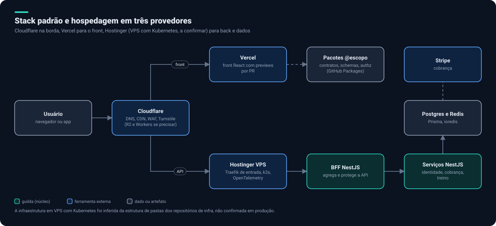
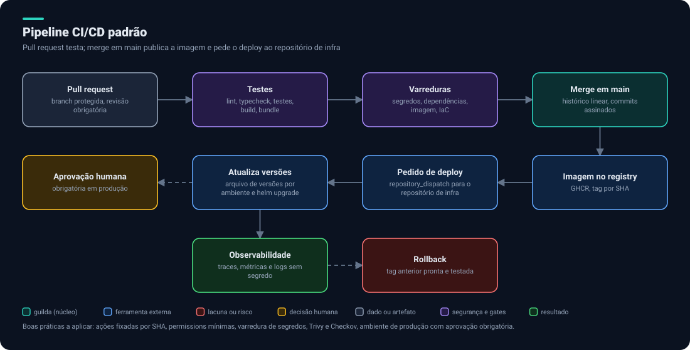

# 6. Stack e hospedagem

> Esta página resume **tecnologias e padrões** observados nos projetos do produto (front web, landing page, BFF, identidade, cobrança, treino, pacotes compartilhados, infraestrutura e um hub de documentação). Por serem privados, não aparecem nomes de repositórios, domínios nem endereços.

## Stack observada

| Camada | O que usam hoje |
|---|---|
| Linguagem | TypeScript em tudo; Node 22 na maioria (24 em um serviço) |
| Gerenciador | pnpm 9.15; pnpm 12 em um serviço |
| Monorepo de pacotes | Turborepo e Changesets, publicados no GitHub Packages com escopo da organização |
| Front web | React 18, Vite 6, Tailwind 3.4, Zod, TanStack Query, React Hook Form, Storybook, Vitest, MSW, Cypress |
| Landing page | React 19, Vite 8, TypeScript 6, ESLint 10, Vitest |
| Kit de interface (público) | React 18, Vite 5, Tailwind 3.4, Playwright, tokens e ícones |
| Back | NestJS (10 e 11), Zod, `jose` para tokens, `ioredis`, Stripe |
| Banco | PostgreSQL com Prisma (5 e 7) |
| Lint e formato | Biome no back, ESLint no front |
| Testes | Vitest no back; Cypress e Vitest no front; contratos e testes de banco |
| Contêineres | Dockerfile por serviço; imagens no GHCR |
| Orquestração | Helm, Kubernetes, Traefik, OpenTelemetry, Temporal e Postgres/Redis em compose para desenvolvimento |
| CI/CD | GitHub Actions; deploy por `repository_dispatch` para o repositório de infraestrutura |

## Stack padrão proposta

| Camada | Padrão |
|---|---|
| Linguagem | TypeScript estrito, Node ≥ 22, pnpm |
| Front | React 19, Vite, Tailwind, Zod, TanStack Query, React Hook Form, Storybook |
| Back | NestJS, Prisma, PostgreSQL, Redis, Zod, `jose` |
| Lint | Biome no back, ESLint no front |
| Testes | Vitest e MSW; **Playwright** no lugar de Cypress |
| Pacotes | Turborepo e Changesets |
| Qualidade | testes de contrato, varredura de segredos no CI |
| Entrega | contêiner por serviço, Helm, GitHub Actions |

## Divergências a alinhar

| Tema | Hoje | Proposta |
|---|---|---|
| React | 18 no front web, 19 na landing page | Alinhar em 19 quando as dependências permitirem |
| Vite, TypeScript, ESLint | Versões muito diferentes entre front e landing | Escolher uma linha por vez, com pacote compartilhado |
| NestJS e Prisma | 10 e 5 na maioria; 11 e 7 em um serviço | Planejar a subida dos demais ou documentar o motivo |
| Node | 22 e 24 | Fixar o mínimo no `engines` de todos |
| E2E | Cypress no front web; Playwright no kit de interface | Playwright em todos |
| `CLAUDE.md` | Texto herdado de template antigo (Python, AWS Lambda, MikroORM, Cognito) | Substituir pelo gerado pela v2.0 do `guilda` |
| Lint | `lint` com `continue-on-error` em uma pipeline por erros herdados | Corrigir os erros e remover a tolerância |
| Repositório antigo | Um monorepo com `apps/` e `infra/` que parece duplicar a divisão atual em repositórios separados | Decidir: arquivar ou documentar o papel |
| Domínio real | Aparece em arquivos de configuração e de instrução em vários projetos | Mover para variável de ambiente e parametrizar |

## Hospedagem em três provedores

> A infraestrutura em VPS com Kubernetes é **inferida** da estrutura de pastas dos repositórios de infraestrutura (`helm`, `k8s`, `traefik`, `otel`), não confirmada em produção. Confirmar antes de assumir privilégios.

| Provedor | Papel proposto | Ferramenta de operação | Papel do `guilda` |
|---|---|---|---|
| **Cloudflare** | Borda: DNS, CDN, WAF, Turnstile; R2 e Workers se precisar | Plugin `cloudflare` (foco em Workers) | **Novo** papel `cloudflare` ([lacuna 2](09-lacunas-e-decisoes.md)); `ingress` para TLS e headers |
| **Vercel** | Front React com previews por PR e produção | Plugin `vercel` | **Novo** papel `vercel` (leve, no molde de `hosting`) |
| **Hostinger** | VPS para back, dados e observabilidade | Plugin `hostinger` | `hosting` (conhecimento) e perfil `vps-k3s`; `kubernetes`, `docker`, `sre` |

Convenções transversais:

- **HTTPS em tudo,** com renovação automática de certificado.
- **DNS:** o TTL de produção em 3600 s; baixar para 300 s só antes de uma migração e restaurar depois. Propagação de até 48 horas.
- **Um subdomínio por app e ambiente** (por exemplo `api.` e `staging.`), sem roteamento por caminho entre apps.
- **Cache:** não passar a API pela CDN; respostas da API com `Cache-Control` `no-store` ou `private`; limpar o cache depois de cada deploy do front.
- **Banco:** nunca expor a porta do banco à internet pública.
- **E-mail transacional:** serviço dedicado, não o SMTP da hospedagem; SPF, DKIM e DMARC antes de ligar.
- **Variáveis e segredos:** no painel do provedor ou no gerenciador de segredos; nunca em `.env` versionado.
- **Rollback:** artefato anterior ou tag pronta antes de cada deploy de produção.
- **Operação destrutiva** (apagar domínio, banco ou conta de e-mail) sempre com sua aprovação.

## Pipeline de CI/CD

Padrão observado: pull request roda testes; push em `main` publica a imagem no registry e pede o deploy ao repositório de infraestrutura, que atualiza o arquivo de versões do ambiente e roda o `helm upgrade`.

Endurecimento proposto ([critérios 36 a 39](05-seguranca-e-privacidade.md#f-cadeia-de-suprimentos-e-cicd)):

- Fixar as ações por SHA e declarar `permissions` mínimas.
- Varredura de segredos, dependências, imagem (Trivy) e IaC (Checkov) no CI.
- Branch protegida, CODEOWNERS, commits assinados e Dependabot.
- Ambiente de produção com aprovação obrigatória no GitHub.
- Imagem com tag por SHA, nunca só por nome de ambiente.

## Observações de cobertura

Os agentes de infraestrutura listados no `guilda` e o plugin `aws-core` mencionam AWS, mas **não vimos uso de AWS** na stack observada. O `finops` do `guilda` é centrado em AWS e precisa de adaptação para custos de VPS, Cloudflare e Vercel.

Próximo: [GitHub Projects](07-github-projects.md).
