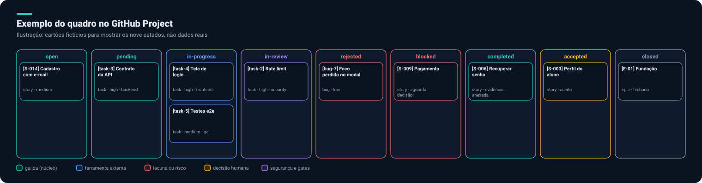
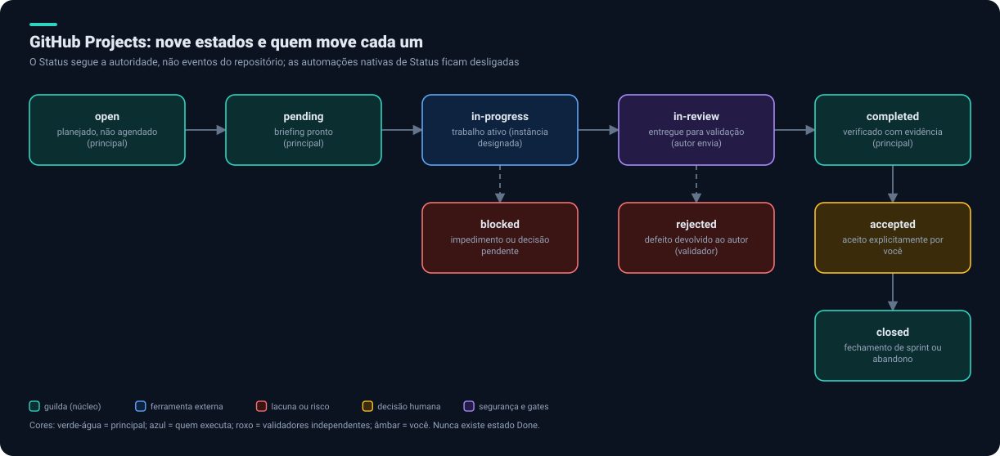

# 7. GitHub Projects

O GitHub Projects é o **registro durável de execução e aceite**. Esta página combina o contrato do `guilda` (`core/workflow/github-projects.md`) com boas práticas gerais do GitHub.

## O quadro

Cada cartão é uma **issue**, criada no repositório onde o trabalho acontece e adicionada a um único Project, de modo que trabalho espalhado por vários repositórios aparece em um só quadro. Código, evidência e logs ficam no workspace e são **linkados**, nunca colados na issue.

## Estados e autoridade

São exatamente **nove** estados; o `Todo / In Progress / Done` padrão é removido.

| Estado | Significado | Quem move |
|---|---|---|
| `open` | Planejado, não agendado | Principal |
| `pending` | Briefing pronto | Principal |
| `in-progress` | Trabalho ativo | Instância designada, antes de agir |
| `in-review` | Entregue para validação | Autor envia; validadores iniciam |
| `rejected` | Defeito devolvido para correção | QA, revisão ou segurança |
| `blocked` | Impedimento ou decisão pendente | Quem detectou, avisando o principal |
| `completed` | Verificado com evidência, aguardando seu aceite | Principal |
| `accepted` | Aceito explicitamente por você | Você (ou o principal registrando sua decisão escrita) |
| `closed` | Fechamento de sprint ou abandono explícito | Principal |

Regras importantes:

- **`completed` exige evidência:** o principal reexecuta ao menos um comando de evidência. Um cartão sozinho não prova nada (origem: um subagente já marcou tarefa como concluída sem commit).
- **Nunca existe `Done`.**
- **As automações nativas que mudam o Status** (item fechado vira Done, PR mergeado, item reaberto) ficam **desligadas**; o Status segue a autoridade da tabela, não eventos do repositório. Só "item adicionado ao projeto" pode marcar `open`.
- O GitHub **não impede** quem move o cartão. Texto não é enforcement, então o principal audita o histórico de Status na verificação.
- Agentes **não são usuários do GitHub**: o campo `Agent` identifica a função e a instância; `assignee` é só para humanos.

## Campos do Project

| Campo | Tipo | Valores |
|---|---|---|
| Status | Seleção única | os nove estados |
| Priority | Seleção única | `critical`, `high`, `medium`, `low` |
| Type | Seleção única | `epic`, `story`, `task`, `bug`, `spike` |
| Estimate | Número | pontos ou tamanho (definido pelo Product Owner) |
| Agent | Texto | função e token da instância |
| Sprint | Iteração | opcional |
| Due date | Data | opcional |
| Completed at | Data | só o principal, ao mover para `completed` |

## Hierarquia e nomes

- **Epic → story → task**, com **sub-issues nativas**. Em vários repositórios, histórias moram no hub e tarefas nos repositórios que mudam.
- Títulos: `[E-NN]` para épicos, `[S-NNN]` para histórias, `[task-N-papel]` para tarefas (por exemplo `[task-3-qa]`). O ID vive no título e em um rótulo; o número da issue é só o link.
- Rótulos: `role:<função>`, `type:<epic|story|bug|spike>`, `tier:<deep|standard|light>` (opcional), `task-N`, `checkpoint`, `retroativo`, `abandonado`.
- Para tarefa substancial, **3 a 8 checkpoints** de capacidade como sub-issues, não micro-passos.
- Carimbos de tempo em UTC ISO 8601; bloqueios guardam o estado anterior no corpo da issue.
- Uma história só é despachada depois da **Definition of Ready** e só chega a `completed` depois da **Definition of Done**.

## Como configurar

O `guilda` traz o perfil `github-projects` e dois scripts em `integrations/github-projects/`: `setup-labels.sh` e `setup-project.sh`. Eles **só criam campos e rótulos**; desligar as automações de Status é feito pelo principal, na interface, porque a CLI não prova que foram desligadas.

Acesso: `gh` (token com escopos `repo` e `project`) ou o plugin `github`. Nunca pedir escopo maior e nunca guardar token em issue, arquivo ou log. Se o quadro não puder ser escrito, o cartão fica com o principal como atualização pendente e o bloqueio é registrado: **nunca** cair silenciosamente para outro rastreador.

## Boas práticas gerais do GitHub a somar

Estas não vêm do `guilda`; são recomendações para o repositório e o fluxo ([critérios 36 a 39](05-seguranca-e-privacidade.md#f-cadeia-de-suprimentos-e-cicd)):

| Prática | Por quê |
|---|---|
| Rulesets ou branch protection em `main` | Exigir PR, revisão e checagens antes do merge |
| `CODEOWNERS` | Revisão automática pelo dono do código |
| Formulários de issue e modelo de PR | Entrada padronizada (requisito, tarefa, bug) |
| Issue types, sub-issues e iterações | Estruturar épicos, histórias e sprints |
| Ambientes com aprovação obrigatória | Proteger produção |
| Commits assinados | Autoria verificável |
| Dependabot e alertas de segredo | Dependências e vazamentos monitorados |
| Permissões mínimas no `GITHUB_TOKEN` | Reduzir o impacto de um workflow comprometido |
| Um Project por produto, não por repositório | Visão única do trabalho |

Próximo: [Guilda versus planejamento](08-guilda-vs-planejamento.md).
