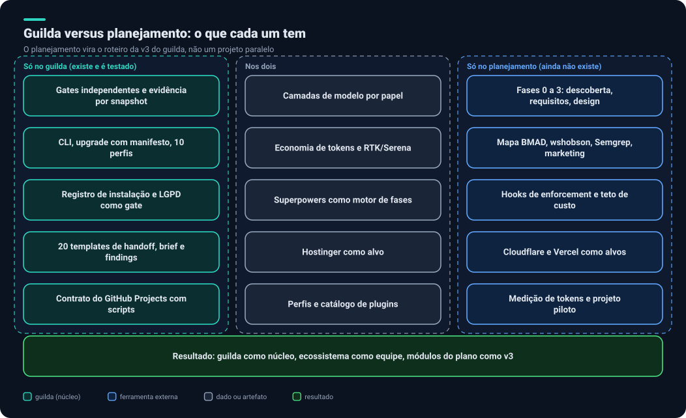
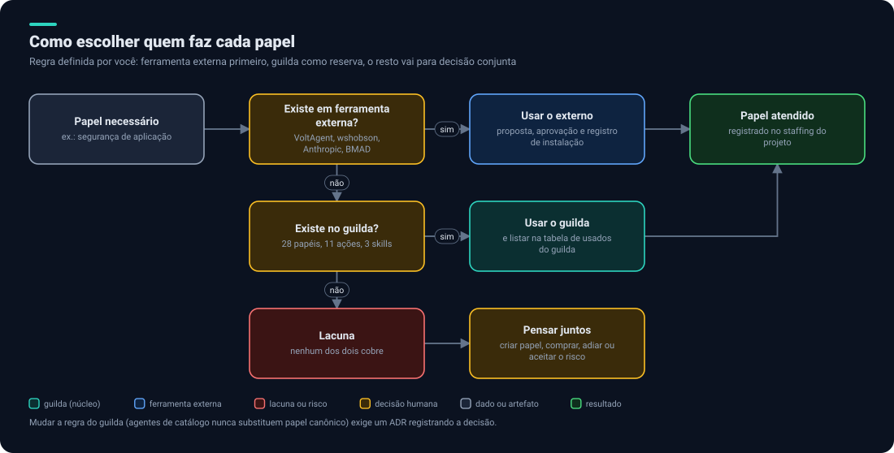

# 8. Guilda versus planejamento

## Contexto

O `PLANEJAMENTO.md` original (hoje em [`historico/planejamento-v0.md`](historico/planejamento-v0.md)) foi escrito **antes** de analisarmos o `guilda`. Ele é um documento, não um produto. O `guilda` é um produto existente. A pergunta é como combinar os dois.

## O que cada um tem

**Só no `guilda` (existe e é testado):**

- Código: CLI em Python, 10 arquivos de testes, CI e release; distribuído como pacote.
- `upgrade` com manifesto por arquivo: não sobrescreve o que você alterou sem aprovação.
- 10 perfis (`base`, `python`, `aws-serverless`, `github-projects`, `hosting-managed`, `nestjs-mikroorm`, `polyrepo`, `product-team`, `session-continuity`, `vps-k3s`).
- Gates independentes e evidência por snapshot.
- Política de instalação com registro.
- LGPD como gate; usabilidade e teste com usuário leigo.
- 20 templates de handoff, brief, findings, spec, decisão e postmortem.
- Contrato do GitHub Projects com scripts de criação.
- Continuidade de sessão e o mod `token-handoff`.
- Skills de diagramas e README.

**Nos dois:** camadas de modelo, economia de tokens (RTK, Serena), Superpowers como motor, Hostinger, perfis e catálogo de plugins.

**Só no planejamento (ainda não existe):**

- Fases 0 a 3 (descoberta, requisitos, design, arquitetura) com agentes de negócio.
- Mapa de plugins do ecossistema: BMAD, wshobson, Semgrep, marketing.
- Hooks de enforcement e teto de custo.
- Cloudflare e Vercel como alvos.
- Medição de tokens com linha de base e projeto piloto.
- Análise de gateways e dos riscos do OmniRoute.

## Prós e contras

| | `guilda` | Planejamento |
|---|---|---|
| **Prós** | Existe, é testado, versionado e já está nos seus projetos. Governança forte. Atualização segura | Cobre o ciclo inteiro. Aproveita o ecossistema. Já pensa em enforcement e medição |
| **Contras** | Cobertura fraca em produto e negócio. Regras só em texto. Cada projeto recebe cópias (risco de deriva). Gates estritos custam tokens. Só conhece Hostinger | Não existe. Reinventa o que o `guilda` já tem. Governança mais leve. Depende de muitos plugins externos |

Pontos de atenção do `guilda` que influenciam as decisões:

- **Deriva de versão:** os projetos do produto têm uma versão antiga, com agentes que citam uma stack que não é a real.
- **Peso de contexto:** 28 papéis mais políticas e workflows custam tokens a cada despacho; as regras de economia mitigam, mas não eliminam.
- **Rigidez:** exigir instâncias independentes para autor, QA, revisão e segurança aumenta o custo; o `guilda` aceita esse custo por desenho.
- **Não é um plugin nativo:** o `guilda` copia arquivos no projeto (`.engineering/`) em vez de usar o marketplace de plugins do Claude Code. Isso dá `upgrade` com manifesto, mas não permite `/plugin install`.

## Recomendação

> **Use o `guilda` como núcleo.** Use as ferramentas externas como a equipe de especialistas, como você prefere. O planejamento vira o **roteiro da v3 do `guilda`**, não um projeto paralelo.

### Melhor de cada um

| Do `guilda` | Do ecossistema (planejamento) |
|---|---|
| Gates independentes e evidência | Superpowers como motor de fases |
| Camadas de modelo por papel | VoltAgent para a maioria dos especialistas |
| Registro e critérios de instalação | Plugins oficiais: `github`, `playwright`, `semgrep`, `security-guidance`, `code-review`, `vercel`, `cloudflare`, `hostinger`, `sentry`, `serena`, `figma`, `session-report` |
| Privacidade (LGPD), histórias, usabilidade | RTK e Headroom para tokens |
| Contrato do GitHub Projects | `claude-mem` e Task Observer, após revisão |
| CLI com `sync` e `upgrade` | `block-no-verify` e `hookify` para enforcement |

## Como agregar

1. **Tabela de resolução por papel.** O `guilda` já tem `integrations/plugins/curated.json`, que mapeia papel para plugin. Estender esse arquivo com uma ordem de preferência por papel (externo primeiro, `guilda` como reserva) implementa sua regra no próprio catálogo.
2. **ADR de inversão.** O `guilda` hoje diz que agentes de catálogo nunca substituem papel canônico sem decisão registrada (`workflow/staffing.md`). Registrar a decisão como um ADR e ajustar essa regra.
3. **Pacote único de proposta de plugins.** Cerca de 15 plugins previstos: uma proposta e uma aprovação, com a revisão de segurança de cada um.
4. **Módulos novos no `guilda`:** papéis de fases 0 a 3, `cloudflare`, `vercel`, `financeiro-produto`, `release` e a especialização NestJS + Prisma, no molde do `hosting`.
5. **Enforcement:** hooks e regras de bloqueio escritos e verificados.
6. **Atualizar os projetos do produto** para a 2.0 com `guilda upgrade --dry-run` e depois `guilda upgrade`, o que também corrige o `CLAUDE.md` herdado.

### Onde o trabalho acontece

Duas opções, a decidir ([decisões](09-lacunas-e-decisoes.md#decisões-em-aberto)):

| Opção | Prós | Contras |
|---|---|---|
| **A. Branch do próprio `guilda`** (v3) | Um só lugar; o `upgrade` já distribui | Mexe em um repositório público e em uso |
| **B. Projeto separado que consome o `guilda`** | Isola a experimentação; este repositório já existe | Duas fontes de verdade se não houver disciplina |

Proposta: **começar pela B** para experimentar com segurança e **promover o que funcionar** para o `guilda`, como o próprio `guilda` já prevê com `promote`.

Próximo: [Lacunas e decisões](09-lacunas-e-decisoes.md).
