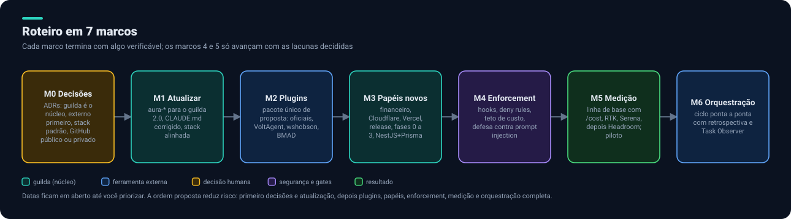

# 10. Roteiro

Sete marcos, cada um com um critério verificável. As datas ficam em aberto até você priorizar. A ordem reduz risco: primeiro decisões e atualização, depois plugins, papéis, enforcement, medição e a orquestração completa.

| Marco | Entrega | Critério de pronto |
|---|---|---|
| **M0 Decisões** | ADRs: `guilda` é o núcleo, externo primeiro, stack padrão, visibilidade deste repositório | ADRs aprovados por você |
| **M1 Atualizar** | Projetos do produto no `guilda` 2.0; `CLAUDE.md` corrigido; stack alinhada nos pontos acordados | `guilda upgrade --dry-run` sem conflitos não resolvidos; agentes deixam de citar a stack errada |
| **M2 Plugins** | Pacote único de proposta: oficiais, VoltAgent e wshobson selecionados, BMAD avaliado | Registro de instalação completo; cada plugin com revisão de segurança, versão fixada e remoção documentada |
| **M3 Papéis novos** | Financeiro de produto, Cloudflare, Vercel, release, fases 0 a 3, perfil NestJS e Prisma | Cada papel com contrato, ferramentas mínimas, tier e teste em um caso real |
| **M4 Enforcement** | Hooks e regras de bloqueio, teto de custo, defesa contra prompt injection | Cada regra testada: a ação proibida é de fato barrada |
| **M5 Medição** | Linha de base de tokens; RTK e Serena medidos; Headroom avaliado; projeto piloto | Relatório antes e depois por ferramenta, com tokens e custo por fase |
| **M6 Orquestração** | Ciclo ponta a ponta com portões, retrospectiva e Task Observer | Uma ideia vira um PR revisado, com todos os gates, sem intervenção além dos portões |

## Projeto piloto sugerido

Refazer um dos projetos de interface (landing page ou protótipo) usando o fluxo completo e comparar com o histórico: tokens, tempo, retrabalho e achados nos gates. O piloto valida o M5 e o M6.

## Métricas

- Tokens e custo por fase e por papel.
- Taxa de aprovação nos gates na primeira tentativa.
- Retrabalho por história.
- Tempo da ideia ao primeiro deploy.
- Achados de segurança e privacidade por entrega.

## O que fazer primeiro

1. Decidir o [onde e como](09-lacunas-e-decisoes.md#decisões-em-aberto) (decisões 1 a 3).
2. **Enforcement das regras de maior dano** (lacuna 7): barato, sem dependência e protege tudo que vem depois.
3. Atualizar os projetos do produto para o `guilda` 2.0 (M1).
4. Medir a linha de base de tokens antes de ligar qualquer ferramenta de economia.

Voltar ao [início](../README.md).
