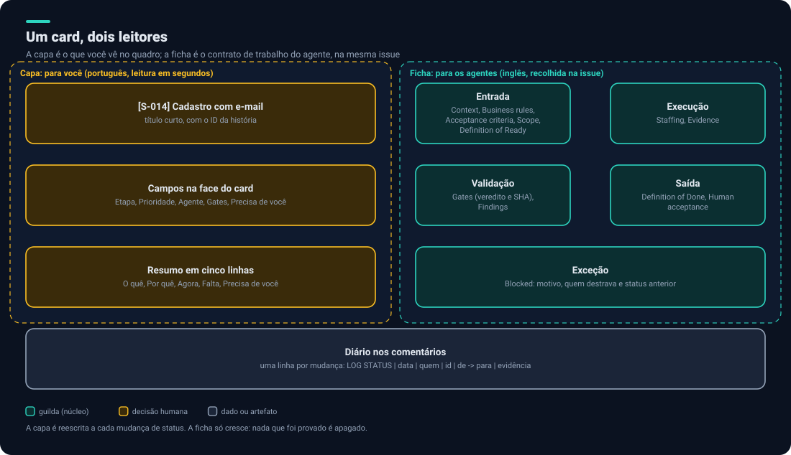
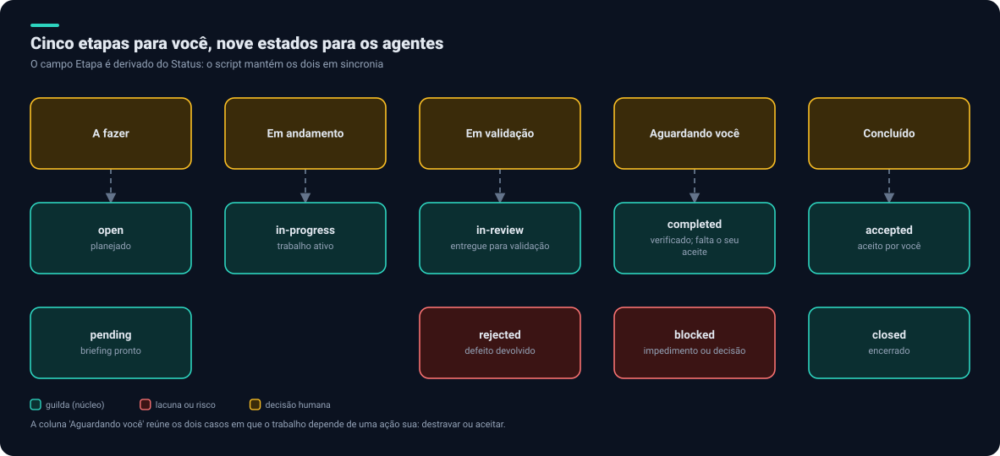
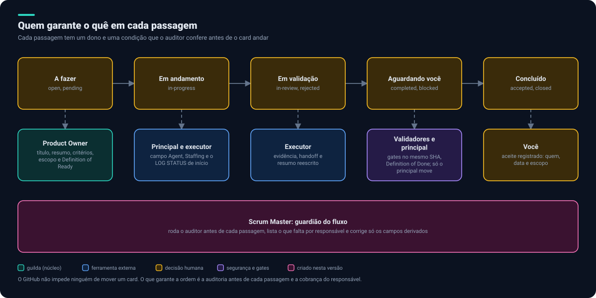
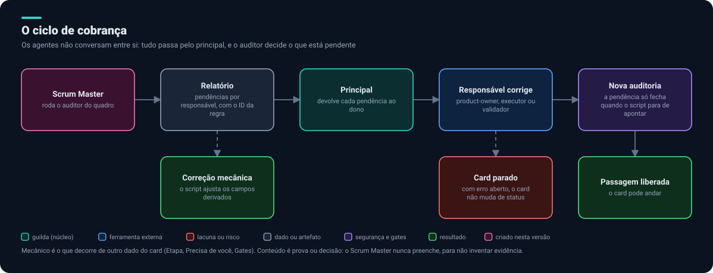
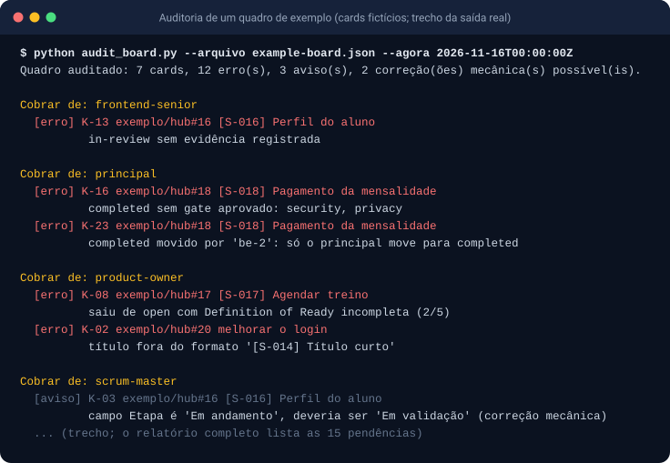
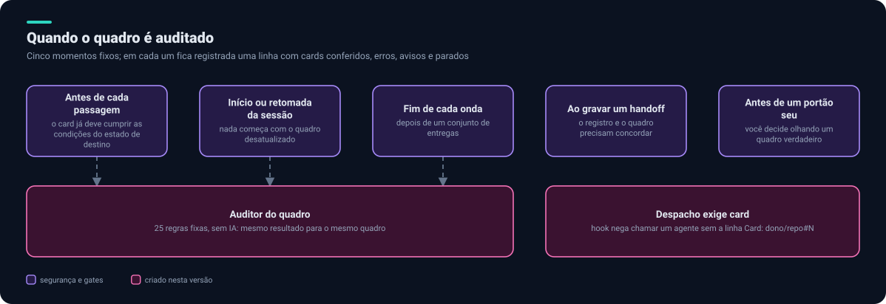
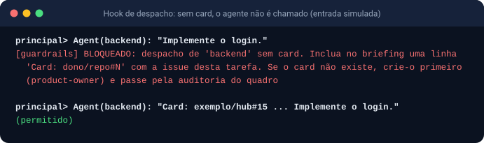
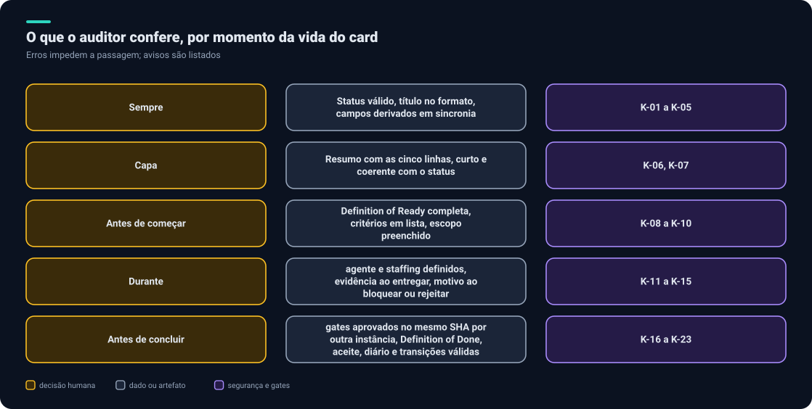

# 12. Gestão por quadro Kanban

Como os agentes trabalham a partir de um quadro no GitHub Projects que **você lê em segundos** e que, ao mesmo tempo, carrega **tudo o que o agente precisa** para executar. E como garantir que o quadro esteja sempre correto, do início ao fim de cada tarefa.

A estratégia tem três ideias:

1. **Um card, duas camadas:** uma capa curta para você e uma ficha detalhada para os agentes.
2. **Cinco colunas para você, nove estados para os agentes:** a visão simples é derivada da precisa.
3. **Correção garantida por auditoria:** um script confere regras fixas, o Scrum Master cobra cada responsável, e o card não anda com pendência aberta.

Está implementada na [`v1`](../v1/README.md), como o perfil opcional `kanban-board`.

> **O que foi verificado.** O auditor tem testes para as regras, usando um quadro fictício. O hook de despacho foi testado com entradas simuladas. **O modo ao vivo do auditor, que lê o GitHub pelo `gh`, não pôde ser testado aqui** e deve ser conferido no primeiro uso. As imagens de terminal mostram saídas reais.

---

## 1. O card em duas camadas



O quadro do GitHub mostra só o título e os campos na face do card. Por isso a leitura rápida vem deles, e o detalhe fica no corpo da issue.

### A capa, para você

- **Título curto** com o ID: `[S-014] Cadastro com e-mail`.
- **Campos na face:** Etapa, Prioridade, Agente, Gates e Precisa de você.
- **Resumo em cinco linhas**, em português e sem jargão, no topo do corpo:

```markdown
## Resumo
- **O quê:** Cadastro com e-mail e senha.
- **Por quê:** Permitir que novos alunos entrem sozinhos.
- **Agora:** Entregue para validação, com o QA.
- **Falta:** Revisão de segurança e QA.
- **Precisa de você:** não
```

O campo **Gates** resume a validação em uma linha: `R✔ S✔ P– Q…` significa revisão aprovada, segurança aprovada, privacidade não se aplica e QA pendente.

O resumo é reescrito a cada mudança de status. Um resumo que descreve um estado anterior conta como defeito.

### A ficha, para os agentes

Fica recolhida dentro da issue, em inglês, e só cresce:

| Momento | Seções |
|---|---|
| Entrada | Context, Business rules, Acceptance criteria, Scope, Definition of Ready |
| Execução | Staffing (quem faz, de qual fonte e com qual modelo), Evidence |
| Validação | Gates (veredito, instância e SHA de cada um), Findings |
| Saída | Definition of Done, Human acceptance |
| Exceção | Blocked: motivo, quem destrava e status anterior |

### O diário

Cada mudança de status é um comentário padronizado, escrito por quem moveu o card:

```
LOG STATUS | 2026-11-15T10:00:00Z | be-1 | S-014 | in-progress -> in-review | docs/evidence/s-014.md
```

É por ele que o auditor sabe quem moveu, quando, e se a passagem era permitida.

Um card por história. Tarefas são sub-issues da história, e histórias são sub-issues do épico.

---

## 2. Cinco etapas para você, nove estados para os agentes



Os nove estados do `guilda` são precisos, mas pesados para ler. Eles continuam no campo `Status`, que é o contrato dos agentes. Para você, o campo `Etapa` agrupa em cinco colunas.

A `Etapa` nunca é editada à mão: ela decorre do `Status`, e o script mantém os dois em sincronia. O mesmo vale para `Precisa de você`, que vira "sim" quando o card está bloqueado ou aguardando o seu aceite.

Três visões do quadro, que você cria na interface do GitHub (a linha de comando não cria visões):

| Visão | Como | Para quê |
|---|---|---|
| **Quadro** | Agrupada por Etapa, mostrando Prioridade, Agente e Gates | Acompanhar o todo |
| **Precisa de mim** | Filtro `Precisa de você: sim` | Ver só o que depende de você |
| **Operação** | Tabela com todos os campos | Auditoria e detalhe |

---

## 3. Quem garante o quê



| Papel | Garante | O que barra |
|---|---|---|
| **Product Owner** (requisitos) | A entrada: título, resumo, critérios em lista, escopo e Definition of Ready | O card não sai de "A fazer" sem isso |
| **Scrum Master** (guardião do fluxo) | O fluxo: passagens válidas, campos exigidos em cada estado, responsáveis presentes, cards parados | Qualquer passagem que falhe na auditoria |
| **Executor** (campo Agente) | O próprio card: registra o início, anexa evidência e handoff, reescreve o resumo | |
| **Validadores** | Veredito, instância e SHA na tabela de Gates; IDs dos achados ao rejeitar | A conclusão sem a aprovação deles |
| **Principal** | Só ele move para `completed`, depois de reexecutar uma evidência | |
| **Você** | Só você move para `accepted` | |

O Scrum Master não escreve requisitos, não implementa, não valida e não aprova. Ele audita, cobra e relata.

---

## 4. O ciclo de cobrança



Os agentes não conversam entre si; tudo passa pelo agente principal. A cobrança funciona assim:

1. O Scrum Master roda o auditor do quadro.
2. O relatório agrupa as pendências **por responsável**, com o ID da regra.
3. As correções mecânicas são aplicadas pelo script.
4. O principal devolve cada pendência de conteúdo ao dono. Enquanto houver erro aberto, o card não muda de status.
5. Uma nova auditoria confirma. A pendência só fecha quando o script para de apontá-la.



### Mecânico e conteúdo

Esta separação é o centro da estratégia:

| | O que é | Quem resolve |
|---|---|---|
| **Mecânico** | Campo que decorre de outro dado do card: Etapa, Precisa de você e Gates | O script, automaticamente |
| **Conteúdo** | Prova ou decisão: evidência, veredito, critério, resumo, motivo de bloqueio, listas de verificação | O responsável; o Scrum Master só cobra |

O Scrum Master nunca preenche conteúdo, mesmo quando o valor parece óbvio. Preencher seria transformar uma prova que falta em uma prova inventada.

---

## 5. Quando o quadro é auditado



São cinco momentos fixos. Em cada um fica uma linha de registro: cards conferidos, erros, avisos, parados e aguardando você.

O auditor é um programa com regras fixas, sem IA. O mesmo quadro produz sempre o mesmo resultado. Por isso o Scrum Master pode rodar no modelo mais barato: o julgamento dele entra só onde uma regra não enxerga, como um resumo preenchido mas errado.

### Despacho exige card

Um hook impede o principal de chamar um agente sem citar o card no briefing:



Ficam isentos a exploração somente leitura e o próprio Scrum Master. O hook confere só se a referência está presente; ele não consulta o GitHub. Quem verifica o estado do card é o auditor.

---

## 6. O que o auditor confere



| Regra | Confere | Cobra de |
|---|---|---|
| K-01 | O Status é um dos nove estados | Scrum Master |
| K-02 | Título no formato `[S-014] Título curto` | Product Owner |
| K-03 a K-05 | Etapa, Precisa de você e Gates batem com a origem (mecânico) | Scrum Master |
| K-06, K-07 | Resumo com as cinco linhas, curto e coerente com o Status | Executor (Product Owner antes de começar) |
| K-08 a K-10 | Saiu de `open` com Definition of Ready completa, critérios em lista e escopo | Product Owner |
| K-11, K-12 | Agente e Staffing definidos enquanto há trabalho ativo | Principal |
| K-13 | Evidência presente a partir de `in-review` | Executor |
| K-14 | `rejected` traz os IDs dos achados | Validador |
| K-15 | `blocked` traz motivo, quem destrava e status anterior | Executor |
| K-16 a K-18 | Gates exigidos aprovados, no mesmo SHA, por instância diferente do autor | Principal |
| K-19, K-20 | Definition of Done completa; aceite humano registrado | Principal |
| K-21 a K-23 | Diário bate com o Status; toda passagem é válida; `completed` pelo principal e `accepted` por você | Quem moveu |
| K-24 | Card parado além do prazo (24 h em andamento ou validação, 7 dias pendente ou bloqueado, 30 dias aberto) | Executor ou Product Owner |
| K-25 | Cards demais em andamento no mesmo repositório | Principal |

Erros impedem a passagem; avisos são listados. Privacidade vira gate obrigatório quando o escopo diz que há dado pessoal.

---

## 7. Como usar

```sh
# Instalar a v1 já traz o perfil kanban-board
python3 v1/scripts/guilda_v1.py montar
python3 v1/scripts/guilda_v1.py instalar /caminho/do/projeto

# Criar os campos no Project (depois do script de projeto do guilda)
bash .engineering/integrations/kanban/setup-kanban-fields.sh <dono> <número>

# Auditar
python .engineering/integrations/kanban/audit_board.py --owner <dono> --projeto <número>
python .engineering/integrations/kanban/audit_board.py --owner <dono> --projeto <número> --aplicar
```

Dentro do Claude Code, a ação `/board` chama o Scrum Master para auditar o quadro ou um card antes de uma passagem.

Sem o `gh` disponível, o auditor lê um arquivo com o quadro exportado (`--arquivo`). O formato está em [`v1/overlay/integrations/kanban/README.md`](../v1/overlay/integrations/kanban/README.md).

Para experimentar sem um Project:

```sh
python3 v1/overlay/integrations/kanban/audit_board.py \
  --arquivo v1/overlay/integrations/kanban/example-board.json
```

---

## 8. Decisões que você tomou

| # | Decisão | Como ficou |
|---|---|---|
| 1 | Colunas | Cinco etapas para você, nove estados para os agentes |
| 2 | Poder do Scrum Master | Corrige o mecânico e cobra o resto |
| 3 | Granularidade | Um card por história; tarefas como sub-issues |
| 4 | Idioma | Resumo em português; ficha do agente em inglês |
| 5 | Bloqueio técnico | Hook que nega despacho sem card |

Um ajuste em relação ao combinado no item 2: o papel de Scrum Master é somente leitura, como os demais papéis de diagnóstico do `guilda`. A correção mecânica é feita pelo script, que o principal roda ou autoriza. O efeito é o mesmo, com menos permissão para o agente.

---

## Limites

- **O modo ao vivo não foi testado contra o GitHub real.** Depende do formato de saída do `gh`. O modo por arquivo tem testes.
- **O GitHub não impede ninguém de mover um card.** A auditoria detecta depois; não bloqueia antes.
- **A auditoria confere estrutura e coerência, não verdade.** Um link de evidência pode apontar para nada. Os gates e a reexecução de evidência pelo principal cobrem isso.
- **As visões do quadro são manuais.** A linha de comando do GitHub não cria visões.
- **O campo Etapa duplica o Status.** O script os mantém em sincronia, mas entre duas auditorias eles podem divergir.
- **O hook só confere a presença do card,** não o estado dele.
- **O fluxo ainda não foi usado numa sessão real de trabalho.**

Detalhes do contrato em [`kanban-board.md`](../v1/overlay/core/workflow/kanban-board.md) e do modelo de card em [`kanban-card.md`](../v1/overlay/core/templates/kanban-card.md).

Voltar ao [início](../README.md).
